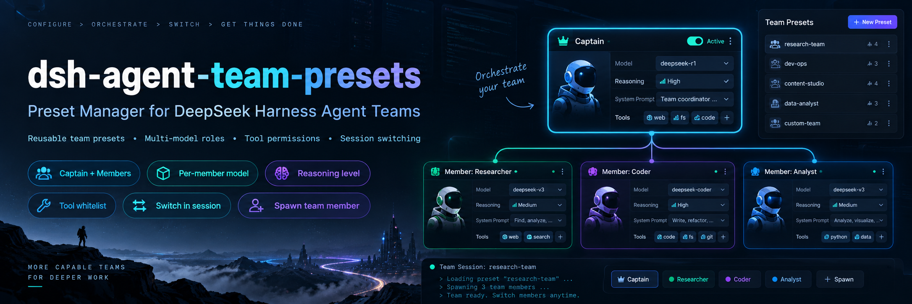

# dsh-agent-team-presets



*Concept illustration. See [Screenshots](#screenshots) for the plugin interface; the captain uses the conversation's selected model.*

English | [中文](<README.zh.md>)

> **Community plugin v0.1.8** · [Release](https://github.com/bloodarea/dsh-agent-team-presets/releases/tag/v0.1.8)
>
> Requires a compatible DeepSeek Harness deployment with Agent Teams enabled. This version supports DSH rc.2 and 0.2.1-rc.2 APIs; see [Requirements](#requirements). Prebuilt artifacts are included, so installation does not require a source build.

<a id="project-introduction"></a>
## Overview

**dsh-agent-team-presets** is a visual Team preset and private skill manager for [DeepSeek Harness](https://github.com/deepseek-ai/deepseek-harness). Configure a Team once, assign per-agent isolated skills, then select it from the conversation composer whenever you need it.

A Team contains a **captain** and any number of **member roles**:

- The captain uses the conversation's selected model, with its own role description, system prompt, and tool policy.
- Each member can have an independent provider, model, reasoning effort, system prompt, tool policy, and assigned Team Skills.
- The captain summons members through `spawn_team_member`; native Agent Teams provides messaging, the shared task board, and runtime coordination.

This is a community plugin, not the Harness's bundled `@deepseek-ai/dsh-experimental-agent-team-presets` development package.

<a id="why-this-plugin"></a>
## Why this plugin?

DeepSeek Harness already ships Agent Teams with multi-agent collaboration. In the Harness versions this plugin supports, per-Team configuration, skill isolation, and reuse are still left to the user, which is what this plugin addresses:

- **Teams are hard to reuse.** In those versions, native teams focus on runtime creation and collaboration, with no visual preset management; this plugin saves, duplicates, categorizes, and reuses named presets.
- **Role setup is repetitive.** Each role's name, description, system prompt, and tool policies are configured once instead of re-described every time.
- **Splitting work across models is awkward.** Every member picks its own model and reasoning effort, so one Team combines models by task, while the captain keeps leading on the Session's model.
- **Tool permissions have no fine-grained entry point.** In those versions the native tool surface offers no per-role allow-list; here the captain and each member carry their own, so roles differ in what they may use.
- **Skills lack per-agent scope isolation.** Shipped or user skills are typically registered globally, making all skills visible to every agent; this plugin provides a private Team Skill library where skills are discovered **only** by the specific Agent they are assigned to.
- **Switching teams is inconvenient.** Pick a preset Team directly from the composer instead of rebuilding roles by hand.

**Design principle:** native Agent Teams owns collaboration at runtime; this plugin owns configuring, managing, isolating, and reusing teams and their skills.

<a id="features"></a>
## Features

- **Reusable Teams:** create, duplicate, edit, select, and delete named presets.
- **Per-member model routes:** assign models and reasoning effort to individual roles without changing the captain's model.
- **Independent tool policies:** choose all available tools or a custom allow-list for the captain and each member.
- **Nine built-in presets across two series:** three software development scale teams (Lightweight, Standard, Full-Stack) and six specialized work-mode teams (Discovery, Planning, Workflow, Engineering, Security Audit, Research).
- **Display metadata:** attach summary, tags, use cases, quick prompts (suggested tasks), and notes per Team. Strictly presentation-only: never injected into the runtime LLM context, saving context tokens.
- **Local categories and search:** organize presets into custom categories via a dedicated category manager; instantly search over name, summary, tags, and use cases in both Settings and the Composer picker.
- **Private Team Skill library:** import skill folders or ZIP archives into a plugin-owned store (`~/.dsh/team-skills`), completely isolated from global host skills.
- **Per-agent skill isolation:** a 3-column assignment grid on member pages assigns skills to specific roles. Assigned skills are registered **strictly in that Agent's scope** when summoned—never leaked globally.
- **Official built-in skills & local overrides:** ships two delivery skills (`github-repository-presentation`, `git-release-hygiene`) and two method skills (`grilling`, `research`), materialized into the private library and pre-bound to engineering, discovery, and research roles. Create local editable overrides and one-click restore them to the built-in copy (`恢复为插件内置版本`).
- **Guarded deletion with blocker modal:** deleting a skill bound to any role, in use by an active member, or required as a dependency is refused, with a confirmation modal detailing every blocking holder.
- **Dependency verification & MCP boundaries:** checks declared CLI executables against host `PATH` (flags found/missing and refuses assignment when absent) and reports declared MCP servers (declarative display; never auto-connected or hard-blocking).
- **Agent-facing tools:** root sessions provide `list_team_skills`, `assign_team_skill`, `unassign_team_skill`, and `remove_team_skill` alongside `get_team_preset` and `update_team_preset`.
- **Live settings feedback:** see whether a Team is idle, busy, or awaiting an update in an online Session.
- **Theme integration:** robust light and dark mode adaptation across all cards, dialogs, inputs, and dropdowns.

## Contents

- [Overview](#project-introduction)
- [Why this plugin?](#why-this-plugin)
- [Features](#features)
- [Screenshots](#screenshots)
- [Requirements](#requirements)
- [Install and upgrade](#use-this-package)
- [Configure and use a Team](#configure-a-team)
- [Display metadata, categories, and search](#metadata-categories-search)
- [Private Team Skills and per-agent isolation](#team-skills)
- [Share presets](#share-presets)
- [Agent-facing tools](#agent-facing-tools)
- [Tool permissions and security](#tool-permissions)
- [Troubleshooting and limitations](#known-limitations-and-deferred-work)
- [How it works](#understand-the-implementation)
- [Development and contributing](#development)
- [Related resources](#further-exploration)
- [License](#license)

<a id="screenshots"></a>
## Screenshots

The screenshots illustrate the v0.1.8 settings interface, Team Skill management, and composer workflow. Example provider and model names depend on your deployment.

**Manage Teams: tabs, search, source and series filters**


**Choose a Team in the composer with search and source filters**


**Private Team Skill library with origin badges and actions**


**Assign Team Skills to a member role**


**Skill details: file tree, editor, and local copy actions**


**Guarded skill deletion with blocking holders modal**


**Manage custom preset categories**


**Team editor: display metadata, category picker, and status notices**


<details>
<summary>More screenshots (model routing, custom dropdowns, prompts, and tool policies)</summary>

**Category dropdown in Team editor**


**Filter Teams by custom source**


**Configure member models and reasoning effort**


**Model picker**


**Captain and member system prompts**


**Tool policy controls**


</details>

<a id="requirements"></a>
## Requirements

- **DeepSeek Harness with the required rc.2 APIs.** Supported versions: `>=0.2.0-rc.2 <0.3.0`. The plugin manager enforces the declared `engines.dsh` range and refuses to install or activate the plugin outside it; the `@deepseek-ai/dsh-*` peer ranges serve package managers and are ignored by that check. This release was verified against **`0.2.1-rc.2`**; `0.2.0-rc.2` was not re-run for 0.1.8. See [package.json](<package.json>).
- **Agent Teams enabled in the target profile.** The standard integration is `@deepseek-ai/dsh-experimental-agent-team-profile`, which supplies the Team service, tools, and Web roster. This plugin configures and manages Teams; it does not replace that subsystem.
- **A Web or Desktop profile with Settings and the required client services.** Install into the profile you actually use, typically `web` for the Web GUI or `desktop` for Desktop.
- **Durable storage and a continuable subagent backend for member execution.** Member creation is refused if the storage domain or selected execution backend is unavailable. The default backend names are `spawn` and `fork`.

The plugin version (`0.1.8`) and the Harness version (`0.2.1-rc.2`, for example) are separate version lines.

<a id="use-this-package"></a>
## Install and upgrade

### One-click install in the GUI (Add plugin)

Open **Global panels → Plugins → Add plugin**, paste the line below into **Package name or address**, and click **Install**:

```text
dsh-agent-team-presets@0.1.8
```

<!-- release-version: keep in sync with package.json version -->

- **Registry** selects which npm source the download comes from. **Default registry** uses pnpm's own configuration. Pick **Official npm registry** to bypass a mirror, or **Custom address** for an internal or cloud mirror.
- `@0.1.8` pins the version; omit it to install the latest published package.
- The field accepts package names, `name@version`, `github:owner/repo`, tarball URLs, or absolute filesystem paths.
- This package declares `dsh.bundle`, so the plugin manager automatically registers it as a profile bundle layer; do not add a loader entry by hand.
- Once installed, reinstalling the same package identity is blocked. To switch sources (e.g. from GitHub to npm), uninstall first, then install the new spec.
- After installation, reload or restart as prompted.

### Install from GitHub

To receive repository update notifications:

```sh
dsh plugin --profile <profile> add github:bloodarea/dsh-agent-team-presets
```

Replace `<profile>` with your active profile (e.g. `web` or `desktop`):

```sh
dsh plugin --profile web add github:bloodarea/dsh-agent-team-presets
```

To pin the v0.1.8 release tag:

```sh
dsh plugin --profile <profile> add github:bloodarea/dsh-agent-team-presets#v0.1.8
```

### npm release channel

GitHub and [npm](https://www.npmjs.com/package/dsh-agent-team-presets) are separate release channels. Verify the published version on npm before installing:

```sh
npm view dsh-agent-team-presets version
dsh plugin --profile <profile> add dsh-agent-team-presets
```

### Verify and upgrade safely

After installation, follow the plugin manager's reload/restart prompts and navigate to **Settings → Agent team presets**. Verify that details display `dsh-agent-team-presets`, version `0.1.8`, and a running component.

- Back up profile settings, Team definitions, and Session selections before upgrading.
- When migrating from a development link, remove `@deepseek-ai/dsh-experimental-agent-team-presets` first before enabling the community package.
- Restart Harness after switching package identities, then refresh the GUI.

> **Install the bundle; do not add a second loader declaration.** The package already supplies its own [bundle patch](<cordis.patch.yml>). Duplicate hand-written declarations in profile patches can prevent settings from saving. See [Configuration writes are overridden](#configuration-overridden).

<a id="configure-a-team"></a>
## Configure and use a Team

1. Open **Settings → Agent team presets**.
2. Select a built-in Team, duplicate an existing one, or click **New Team**.
3. Configure its name, purpose, display metadata, category, captain, and member roles.
4. For each member, configure its provider/model route, reasoning effort, tool policy, and assigned Team Skills.
5. Press **Save** in the shared footer. Edits remain staged drafts until saved.
6. Select the Team from the conversation composer's Team control, then prompt the captain to coordinate the task.

Example prompt for a Team with execution and review roles:

> Use the selected Team. Have the executor implement the agreed changes and regression tests, then ask the reviewer to inspect them independently. Summarize changes, test results, and remaining risks.

A preset role is a template. Summoning creates an instance with a unique target such as `executor` or `executor-2`. Use `send_message` with the returned target to continue working with an existing instance rather than spawning a new one.

Selecting **No team** disarms the Team application once the captain and teammates become idle, restoring standard session contributions without changing the active model.

### Fields

| Field | Purpose |
|---|---|
| Team name and purpose | Identify the preset and explain what work it handles. |
| Category | Assign the Team to a local category for organization in lists and picker. |
| Display metadata | Summary, tags, use cases, quick prompts, and notes. Purely presentation-only; never injected into LLM context tokens. |
| Captain | The lead agent. A nonempty captain prompt replaces its persona prefix; the captain keeps the conversation's model. |
| Members | Reusable role templates the captain can summon. |
| Name | Role display name and target base. ASCII letters/digits and hyphens (max 64 chars, not `lead`). |
| Description | Role responsibilities for the captain to select appropriate members (max 200 chars). |
| Color | Accent color distinguishing the role in settings and the roster. |
| Provider / Model | Members only. Route from the deployment's model catalog. |
| Reasoning effort | Members only. Options depend on model support; empty uses route default. |
| Allowed tools | Independent all-tools or custom allow-list policy. |
| Team Skills | Assigned private skills, registered exclusively in this Agent's scope upon creation. |
| System prompt | Standing role instructions. `{{variable}}` denotes prompt template variables. |

### Built-in presets

A fresh installation seeds nine editable Teams across two series:

#### 研发规模系列 (Classic Development Scale)

| Preset | Roles | Intended use |
|---|---|---|
| **轻量研发团队**<br>`builtin-lightweight` | Captain, fullstack-advisor, executor | Small features and module iterations. Captain plans and verifies, architecture advisor handles cross-layer technical contracts on demand, executor writes code, tests, and debugs. Pre-bound with official delivery skills. |
| **标准研发团队**<br>`builtin-standard` | Captain, system-architect, executor, code-reviewer | Standard software projects. Captain coordinates, system architect establishes interface contracts and module boundaries, executor develops and tests, independent code reviewer inspects quality. Pre-bound with official delivery skills. |
| **全栈软件研发团队**<br>`builtin-fullstack` | Captain, backend-architect, ui-designer, executor, reviewer | Complex full-stack engineering across Web, Desktop, and Android. Captain leads, backend architect and UI designer provide technical/UX contracts, reviewer enforces quality gates, executor implements. Pre-bound with official delivery skills. |

#### 工作模式系列 (Work Modes)

| Preset | Roles | Intended use |
|---|---|---|
| **需求探索**<br>`builtin-discovery` | Captain, demand-analyst, solution-explorer, independent-challenger | Open-ended ideas where goal, technical path, or product direction is still exploratory; read-only research with independent challenge. |
| **架构规划**<br>`builtin-planning` | Captain, system-architect, technology-evaluator, compliance-auditor | Settled goals where systems, module boundaries, and cross-module contracts must be designed. |
| **既定工作流执行**<br>`builtin-workflow` | Captain, workflow-coordinator, task-executor, delivery-verifier | Established workflows where user specifies next task, and team implements, verifies, and delivers it. |
| **工程研发协作**<br>`builtin-engineering` | Captain, architect-advisor, executor, code-reviewer, repository-specialist | Feature development, cross-layer implementation, UI/UX, and debugging, with a dedicated repository delivery specialist (`repository-specialist`). Pre-bound with official delivery skills. |
| **独立代码与安全审计**<br>`builtin-audit` | Captain, vulnerability-expert, security-auditor, compliance-inspector | Independent read-only review of specified code, vulnerabilities, security configurations, and dependency compliance. |
| **科研协作**<br>`builtin-research` | Captain, domain-researcher, experiment-analyst, rigor-reviewer | Literature review, experiment design, scientific computing, data analysis, and academic rigor inspection. |

Default presets are seeded once per profile. Deleting or editing a built-in preset is respected across restarts. **Restore defaults** restores shipped fields and official rosters while preserving local member model routes and tool policies.

<a id="metadata-categories-search"></a>
## Display metadata, categories, and search

### Presentation-only display metadata

Each Team preset supports rich metadata:
- **Summary**: One-line description shown on cards and intros.
- **Tags**: Keyword chips for filtering and categorization.
- **Use cases**: Recommended project scenarios.
- **Quick prompts**: Ready-to-use task templates shown when selecting the Team.
- **Notes**: Operational reminders or cautions.

**Token economy:** Display metadata is stored in the preset document and used by the UI for search, grouping, and cards, but is **never injected into the runtime LLM prompt context**.

### Local categories and hierarchical filtering

- **Category manager:** Click **管理团队预设分类** in the Settings list to open a dedicated management page. Create, rename, reorder, and delete categories, and inspect team counts per category.
- **Local isolation:** Categories and team-category bindings are saved in profile settings and are **never exported** with shareable preset documents.
- **Two-level filters:** The Teams list provides two independent filter rows:
  - **来源 (Source):** 全部 (All), 插件内置 (Built-in), 自定义 (Custom).
  - **分类 (Category):** For built-in teams, filters by official series (研发规模 / 工作模式); for custom teams, filters by user-created categories.
- **Instant search:** A responsive search box searches team names, summaries, tags, use cases, and quick prompts with real-time matched count reporting.
- **Composer integration:** The conversation composer's Team picker mirrors these source filters and search capabilities, with `不使用团队` pinned to the top.

<a id="team-skills"></a>
## Private Team Skills and per-agent isolation

### Private store and scope isolation

Traditional skills in Harness are typically registered into the global environment, exposing every skill to every agent. This plugin introduces a **Private Team Skill subsystem**:

1. **Private library:** Skills live in a plugin-managed directory (`~/.dsh/team-skills` or storage domain), isolated from host and profile skills.
2. **Per-Agent registration:** When a Team member is summoned, its assigned skills are registered **exclusively inside that member's Agent scope**. Other members and the captain cannot see or invoke them unless explicitly assigned.
3. **Official built-in skills:** four shipped skills: delivery (`github-repository-presentation`, `git-release-hygiene`) and method (`grilling` — clarify before acting; `research` — primary sources only). Default bindings: engineering `executor`/`repository-specialist` receive the delivery skills; the Discovery captain receives `grilling`, its `technical-scout`/`product-scout` and the Research `evidence-scout` receive `research`.
4. **Local overrides & one-click restore:** Built-in skills are read-only by default. Users can create an editable local copy ("本地副本"). If the built-in skill updates in a new plugin version, an `updateAvailable` status is displayed, and users can restore to the built-in copy (`恢复为插件内置版本`) with one click.
5. **Origin labels and badges:** Skills display clear color-coded origin tags across all views:
   - 插件内置 (Built-in, blue)
   - 自定义 (Custom, purple)
   - 本地副本 (Override, amber)

### Import, directory scan, and dependencies

- **Folder and ZIP import:** Import external skill folders or `.zip` packages directly in the Web GUI.
- **Directory scan:** Scans candidate folders in the import path, reporting eligibility and reasons for any rejected folder. Users can copy the absolute library path with one click.
- **Dependency checks and MCP boundaries:**
  - **CLI executables:** Declared CLI executables in `SKILL.md` are resolved against host `PATH`, using `PATHEXT` on Windows. Directories and non-executable files do not satisfy the dependency. Missing required executables are flagged and assignment is refused (`dependency-missing`).
  - **MCP servers (declarative only, not auto-connected):** Declared MCP servers are strictly declarative dependencies displayed in the UI (`skillsDeclared`). The plugin **never connects, launches, or manages** external MCP servers automatically (their lifecycle belongs to the Harness environment and profile). Because MCP connectivity is an environment-level fact, declared MCP servers are reported as `unverified` rather than hard-blocking role assignment. When an MCP server is configured and running in the Harness profile, its exposed tools (`mcp__<server>__<name>`) appear under the MCP tool group in the role's tool configuration and can be authorized via tool policies.
- **Guarded deletion:** Deletion is strongly guarded. If a skill is currently bound to any team role, used by a running member, or required by another skill, deletion is blocked. The confirmation dialog explicitly lists every holding team and member role (e.g. `标准研发团队 → executor`), keeping the confirm button disabled until bindings are cleared.

<a id="share-presets"></a>
## Share presets

**Export** saves one Team as a JSON document (format version 2). **Import preset** reads the document and stages it in the editor.

- **Shared fields:** Team name, purpose, display metadata (summary, tags, use cases, quick prompts, notes), captain/member names, descriptions, prompts, and colors.
- **Local fields:** Model routes, reasoning effort, tool permissions, and local category bindings are **never exported**. Documents containing them are rejected on import.
- **Name collisions:** Choose between replacing the existing preset or creating a renamed copy. Replacement preserves local routes and tool policies on matched roles.
- Review imported prompts before executing tasks, especially when using documents from third parties.

<a id="agent-facing-tools"></a>
## Agent-facing tools

Root sessions register tools allowing agents to inspect and update presets and skills programmatically, subject to tool policies:

### Team preset tools

- **`get_team_preset`**: Reads the active or specified Team preset, returning its purpose, role descriptions, prompts, roster, and settings revision.
- **`update_team_preset`**: Updates team/captain descriptions and member prompts/descriptions using compare-and-set revision checks. Requires direct human turn and Host approval. Returns `team-busy` if affected members are currently active.

### Team Skill tools

- **`list_team_skills`**: Lists installed private Team Skills, origins, dependencies, and role assignment status.
- **`assign_team_skill`**: Assigns one Team Skill to a role in a Team (isolated to that agent scope).
- **`unassign_team_skill`**: Removes a Team Skill assignment from a role.
- **`remove_team_skill`**: Deletes a Team Skill from the library, enforcing blocker checks.

<a id="tool-permissions"></a>
## Tool permissions and security

### Policy modes

- **Default: all tools**: No allow-list restriction beyond deployment permissions and role rules.
- **Custom allowed tools**: Permits only selected tool names. Coordination tools (`send_message`, `list_agents`, `team_task_*`) must be explicitly allowed if needed.
- Captain and member policies are independent. Granting a tool to the captain does not grant it to members.
- **The `skill` tool is always admitted, and is not offered as a choice.** It publishes the catalog and loads instruction text rather than granting a capability, and the Host withholds that whole catalog from an Agent that cannot see it. A custom allow-list therefore cannot remove it, and the settings page does not list it: a checkbox for it would be a control that can never do anything. Documents written by an earlier version that still name it keep loading unchanged — the entry is admitted implicitly, never reported as unavailable, and never needs removing.

### What a member's first turn guarantees

An assigned Team Skill is only useful if the member can load it on the turn that asks for it, so the plugin makes the registration part of member creation rather than a background step:

- **Members**: the creation edge awaits that Agent's own registration before it completes. A role that holds assigned Team Skills but whose deployment cannot publish them — no skill service composed, the private library unreadable, or the registration refused — is **refused at creation** with the reason, instead of starting with an empty catalog while every surface says the skill is bound. Roles with no assignment keep working on deployments that compose no skill service.
- **The captain**: the same registration is performed inside the Session's creation edge, after the Team application it depends on. A captain whose assignment cannot be published does not refuse the Team — a Session that is already running must not lose its capability policy — and the failure is reported at the Agent identity.
- **Unreadable library is not an empty library.** When the private store cannot be opened the plugin cannot even enumerate a role's bindings, so it refuses member creation rather than reading the unknown as "no assignment". Repair the library path (or start again) to recover.

### Known limitation: Windows verification

The path-separator and executable-resolution fixes are exercised by unit tests that normalize separators and by `ENOTDIR` cases, but no Windows machine was available here. Junction handling across volumes, `PATHEXT` resolution against a real `PATH`, and the full native build chain still need a Windows run before the release is described as Windows-verified.

### Security boundaries

- The allow-list is **not a filesystem, process, or network sandbox**. Allowed tools (such as bash) retain their native capabilities. Maintain appropriate Harness sandbox and approval policies.
- Custom policy mode disallows general-purpose `run_code` and ordinary `subagent` / `workflow` delegation to preserve strict policy contracts. Use preset Team members for delegation.
- Managed members require their durable configuration on resume. Missing or corrupted records are refused loud rather than falling back to unrestricted defaults.

<a id="known-limitations-and-deferred-work"></a>
## Troubleshooting and limitations

<a id="configuration-overridden"></a>
### Configuration writes are overridden

If saving or selecting a Team reports:

```text
Configuration for "agent-team-presets" is overridden by a home patch or command-line overlay
```

Check profile patches, `$DSH_HOME/cordis.patch.yml`, and `--patch` overlays for duplicate hand-written `agent-team-presets` declarations. Remove duplicate declarations while preserving Host-managed settings rows.

### Common issues

| Symptom | What to check |
|---|---|
| Settings page is absent or plugin pending | Confirm profile type, peer dependencies, Agent Teams enablement, and client services. |
| Skill deletion button is disabled | The skill is protected: inspect the blocker list in the modal (bound roles or dependencies must be unassigned first). |
| Skill assignment refused (`dependency-missing`) | A required executable declared by the skill is absent from host `PATH`. Note that declared MCP servers are reported for visibility and do not block assignment; ensure MCP servers are configured in your profile. |
| Member creation refused | Check storage domain availability, subagent execution backend (`spawn`/`fork`), model quota, and concurrency limits. |
| Model route display mismatch | In Harness rc.2, `list_agents.model` reports fallback metadata. Verify actual routing via `spawn_team_member`'s `configuredRoute` or session `request/header` logs. |

<a id="understand-the-implementation"></a>
## How it works

The plugin integrates via Cordis and Harness lifecycle extension points without patching host source code:

1. **Profile configuration:** Stores Team presets, display metadata, local categories, and active session selections.
2. **Session application:** Installs captain persona, tool policy, and `spawn_team_member` at Agent scope.
3. **Member creation & skill scoping:** Validates route and delegation limits, persists an instance snapshot, and launches the subagent. The serial `agent/created` hook injects model selection, persona, tool filters, and **assigned Team Skills strictly into that member's Agent scope**.
4. **Private skill manager:** Encapsulates skill storage (`~/.dsh/team-skills`), crash-recovery journaling, dependency resolution, and guarded deletion.

### Source navigation

| Area | Source |
|---|---|
| Plugin lifecycle and settings reconciliation | [src/index.ts](<src/index.ts>), [src/settings-reconcile.ts](<src/settings-reconcile.ts>) |
| Built-in team catalog and series | [src/builtin-teams.ts](<src/builtin-teams.ts>), [src/team-catalog.ts](<src/team-catalog.ts>) |
| Team application and member tool | [src/application.ts](<src/application.ts>) |
| Member snapshots and runtime injection | [src/member-store.ts](<src/member-store.ts>), [src/member-identity.ts](<src/member-identity.ts>), [src/member-runtime.ts](<src/member-runtime.ts>) |
| Private Team Skills subsystem | [src/team-skills/store.ts](<src/team-skills/store.ts>), [src/team-skills/manager.ts](<src/team-skills/manager.ts>), [src/team-skills/service.ts](<src/team-skills/service.ts>), [src/team-skills/tools.ts](<src/team-skills/tools.ts>) |
| Tool policies and presentation | [src/tool-policy.ts](<src/tool-policy.ts>), [src/presentation.ts](<src/presentation.ts>) |
| Preset tools and transfer | [src/preset-tools.ts](<src/preset-tools.ts>), [src/preset-transfer.ts](<src/preset-transfer.ts>) |
| Browser client UI | [src/client/](<src/client/>) |

<a id="development"></a>
## Development and contributing

Source development requires a compatible, dependency-installed [Harness checkout](https://github.com/deepseek-ai/deepseek-harness) with its Host types and generated Typert Remote artifacts built first (the Harness `build:lib:host` pipeline provides them):

```sh
export DSH_CHECKOUT=/absolute/path/to/deepseek-harness
npm test
npm run typecheck
npm run bundle
```

Bug reports and pull requests are welcome at [GitHub Issues](https://github.com/bloodarea/dsh-agent-team-presets/issues) and [Pull requests](https://github.com/bloodarea/dsh-agent-team-presets/pulls).

Thanks to **张灏焱** for contributing the `grilling` and `research` method Team Skills (PR #2), and to Matt Pocock for the upstream [skills](https://github.com/mattpocock/skills) they adapt (MIT, see [NOTICE](<NOTICE>)).

<a id="further-exploration"></a>
## Related resources

- [DeepSeek Harness](https://github.com/deepseek-ai/deepseek-harness) — Host and plugin architecture.
- [Built-in preset documents](<contrib/default-presets>) — Shipped team JSON definitions for reference or custom imports.
- [Bundled skill documents](<assets/skills>) — Shipped skills (`SKILL.md` bundles) materialized into the private library.
- [Method skill upstream](https://github.com/mattpocock/skills) — Source of `grilling` and `research` (MIT; pinned commit recorded in [NOTICE](<NOTICE>)).
- [GitHub Releases](https://github.com/bloodarea/dsh-agent-team-presets/releases) — Published release packages.

<a id="license"></a>
## License

[MIT](<LICENSE>). Bundled dependency notices are in [THIRD-PARTY-NOTICES.txt](<lib/THIRD-PARTY-NOTICES.txt>); source and MIT attribution for the bundled method skills are in [NOTICE](<NOTICE>).
