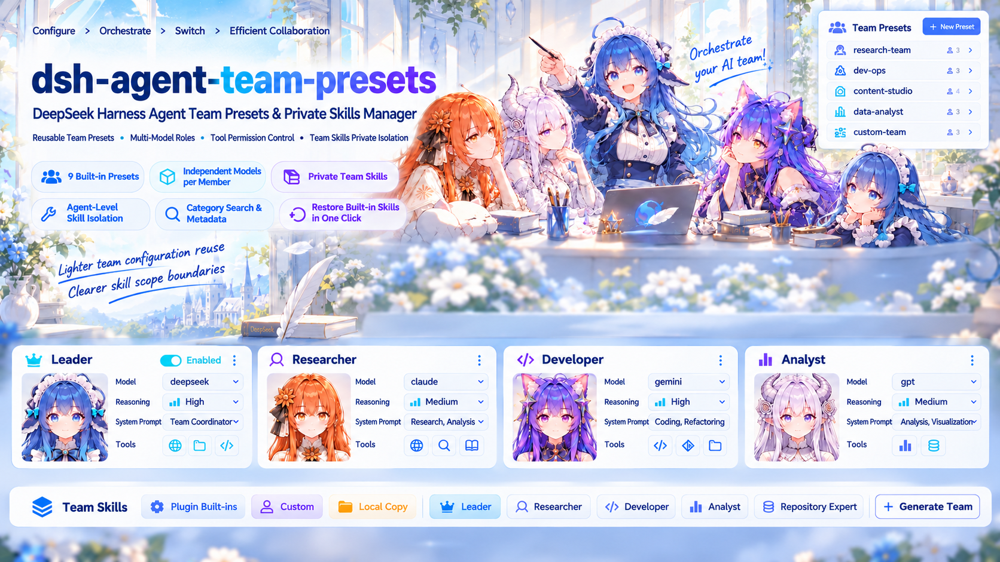

<p align="center">
  
</p>

<h1 align="center">dsh-agent-team-presets</h1>
<p align="center">Reusable Agent Team presets and a private, per-agent Team Skill library for DeepSeek Harness.</p>
<p align="center"><a href="README.zh.md">中文</a></p>

<p align="center">
  <a href="https://github.com/deepseek-ai/deepseek-harness"></a>
  <a href="https://www.typescriptlang.org/"></a>
  <a href="https://www.npmjs.com/package/dsh-agent-team-presets"></a>
  <a href="LICENSE"></a>
</p>

*Concept illustration. The plugin interface is documented screen by screen in [Getting started](docs/guide/getting-started.md); the captain uses the conversation's selected model.*

<a id="project-introduction"></a>
## What Is This?

**dsh-agent-team-presets** is a visual Team preset and private skill manager for [DeepSeek Harness](https://github.com/deepseek-ai/deepseek-harness). Configure a Team once, assign per-agent isolated skills, then select it from the conversation composer whenever you need it.

A Team contains a **captain** and any number of **member roles**:

- The captain uses the conversation's selected model, with its own role description, system prompt, and tool policy.
- Each member can have an independent provider, model, reasoning effort, system prompt, tool policy, and assigned Team Skills.
- The captain summons members through `spawn_team_member`; the Harness subagent runtime provides messaging, execution, and lifecycle.

This is a community plugin, not the Harness's bundled `@deepseek-ai/dsh-experimental-agent-team-presets` development package.

<a id="why-this-plugin"></a>
## Why this plugin?

DeepSeek Harness already ships Agent Teams with multi-agent collaboration. In the Harness versions this plugin supports, per-Team configuration, skill isolation, and reuse are still left to the user:

- **Teams are hard to reuse.** Save, duplicate, categorize, and reuse named presets instead of rebuilding roles each time.
- **Role setup is repetitive.** Each role's name, description, system prompt, and tool policies are configured once.
- **Splitting work across models is awkward.** Every member picks its own model and reasoning effort, while the captain keeps leading on the Session's model.
- **Tool permissions have no fine-grained entry point.** The captain and each member carry their own allow-list, so roles differ in what they may use.
- **Skills lack per-agent scope isolation.** A private Team Skill library is discovered only by the Agent it is assigned to.
- **Switching teams is inconvenient.** Pick a preset Team directly from the composer.

**Design principle:** the Harness subagent runtime owns collaboration at runtime; this plugin owns configuring, managing, isolating, and reusing teams and their skills.

<a id="features"></a>
## Features

- **Reusable Teams:** create, duplicate, edit, select, and delete named presets.
- **Per-member model routes:** assign models and reasoning effort to individual roles without changing the captain's model.
- **Individual member chat:** select one member in the composer to inject that member's role card, tool policy, Team Skills, and model route into the current Session.
- **Independent tool policies:** all tools or a custom allow-list for the captain and each member.
- **Nine built-in presets across two series:** three development-scale Teams and six work-mode Teams; see [Built-in Teams](docs/builtin-teams.md).
- **Display metadata, local categories, and search:** summary, tags, use cases, quick prompts, and notes per Team — presentation only, never injected into the runtime context.
- **Private Team Skill library:** import skill folders or ZIP archives into a plugin-owned store (`~/.dsh/agent-team-presets/team-skills`), isolated from global host skills.
- **Per-agent skill isolation:** a 3-column assignment grid binds skills to specific roles; assigned skills are registered **strictly in that Agent's scope**.
- **Ten shipped Team Skills:** workflow, delivery, and method skills pre-bound to the built-in Teams, with editable local overrides and one-click restore; see [Built-in Team Skills](docs/builtin-team-skills.md).
- **Guarded deletion and dependency checks:** a skill still bound to a role, in use by a running member, or required as a dependency cannot be deleted; declared CLI executables are checked against the host `PATH`.
- **Agent-facing tools:** `get_team_preset`, `update_team_preset`, `list_team_skills`, `assign_team_skill`, `unassign_team_skill`, `remove_team_skill`.
- **Subagent card badges:** tag the subagents a Team created on the Fleet and Tasks cards of supported targets.
- **Live state and theme integration:** see whether a Team is idle, busy, or awaiting an update, with light and dark mode support.

<a id="quick-start"></a>
## Quick Start

### Requirements

- **DeepSeek Harness `>=0.2.2-rc.3 <0.3.0`.** Verified against **`0.2.2-rc.3`**; 0.2.2-rc.2 and older are refused. The plugin manager enforces `engines.dsh` from [package.json](<package.json>).
- **A Web or Desktop profile with Settings and the required client services** — typically `web` for the Web GUI or `desktop` for Desktop.
- **Durable storage and a continuable subagent backend** for member execution; the default backend names are `spawn` and `fork`.
- Custom tool allow-lists have their own execution model; see [Tools and permissions](docs/reference/tools-and-permissions.md).

The plugin version (`0.3.3`) and the Harness version (`0.2.2-rc.3`, for example) are separate version lines.

### Install

#### Option 1 — npm package (recommended; receives update prompts)

Open **Global panels → Plugins → Add plugin**, paste the line below into **Package name or address**, and click **Install**:

```text
dsh-agent-team-presets
```

<!-- release-version: keep in sync with package.json version -->

Or install it from the CLI:

```sh
dsh plugin --profile <profile> add dsh-agent-team-presets
```

Floating GitHub installs, reproducible pins, registry choice, and the install notes are covered in [Install and upgrade](docs/guide/install.md).

### Verify

Open **Settings → Agent team presets** and confirm the plugin reports the version you just installed and a running component. Upgrades, backups, and the "do not add a second loader declaration" rule are in [Install and upgrade](docs/guide/install.md).

<a id="documentation"></a>
## Documentation

The README is the entry point. Every document below ships with the package except the illustrated walkthrough, which is repository-only because it references screenshots the tarball does not carry.

| If you want to | Read |
|---|---|
| Install the plugin and see it work, screen by screen | [Getting started](docs/guide/getting-started.md) — the illustrated walkthrough |
| Choose an install channel, pin a version, upgrade safely | [Install and upgrade](docs/guide/install.md) |
| Configure a Team, its members, metadata, and categories | [Using Teams](docs/guide/using-teams.md) |
| Understand the private Team Skill library and preset sharing | [Private Team Skills](docs/guide/team-skills.md) |
| Add the subagent card badges | [Integrations](docs/guide/integrations.md) |
| Review agent-facing tools, tool policies, and security boundaries | [Tools and permissions](docs/reference/tools-and-permissions.md) |
| Diagnose a Team, member, or install problem | [Troubleshooting](docs/reference/troubleshooting.md) |
| Work on the plugin itself | [Architecture and development](docs/developer/architecture.md) |
| See the nine built-in Teams and their roles | [Built-in Teams](docs/builtin-teams.md) |
| See the ten shipped Team Skills and their bindings | [Built-in Team Skills](docs/builtin-team-skills.md) |
| Browse every document | [Documentation index](docs/index.md) |

<a id="development"></a>
## Development and contributing

Source development requires a compatible, dependency-installed [Harness checkout](https://github.com/deepseek-ai/deepseek-harness) with its Host types and generated Typert Remote artifacts built first (the Harness `build:lib:host` pipeline provides them). The command set, source map, and architecture are in [Architecture and development](docs/developer/architecture.md).

Bug reports and pull requests are welcome at [GitHub Issues](https://github.com/bloodarea/dsh-agent-team-presets/issues) and [Pull requests](https://github.com/bloodarea/dsh-agent-team-presets/pulls).

Thanks to **张灏焱** for contributing the `grilling` and `research` method Team Skills (PR #2), and to Matt Pocock for the upstream [skills](https://github.com/mattpocock/skills) they adapt (MIT, see [NOTICE](<NOTICE>)).

<a id="release-notes"></a>
## Release notes

Latest tagged release **v0.3.2** keeps several upstream versions patchable at once and raises the host requirement to **DeepSeek Harness 0.2.2-rc.3**. Notes, assets, and the full history are on the [Releases](https://github.com/bloodarea/dsh-agent-team-presets/releases) page.

<a id="further-exploration"></a>
## Related resources

- [DeepSeek Harness](https://github.com/deepseek-ai/deepseek-harness) — Host and plugin architecture.
- [Built-in preset documents](<contrib/default-presets>) — shipped team JSON definitions for custom imports.
- [Bundled skill documents](<assets/skills>) — shipped skills materialized into the private library.
- [Method skill upstream](https://github.com/mattpocock/skills) — source of `grilling` and `research` (MIT; pinned commit in [NOTICE](<NOTICE>)).

<a id="license"></a>
## License

[MIT](<LICENSE>). Bundled dependency notices are in [THIRD-PARTY-NOTICES.txt](<lib/THIRD-PARTY-NOTICES.txt>); source and MIT attribution for the bundled method skills are in [NOTICE](<NOTICE>).
