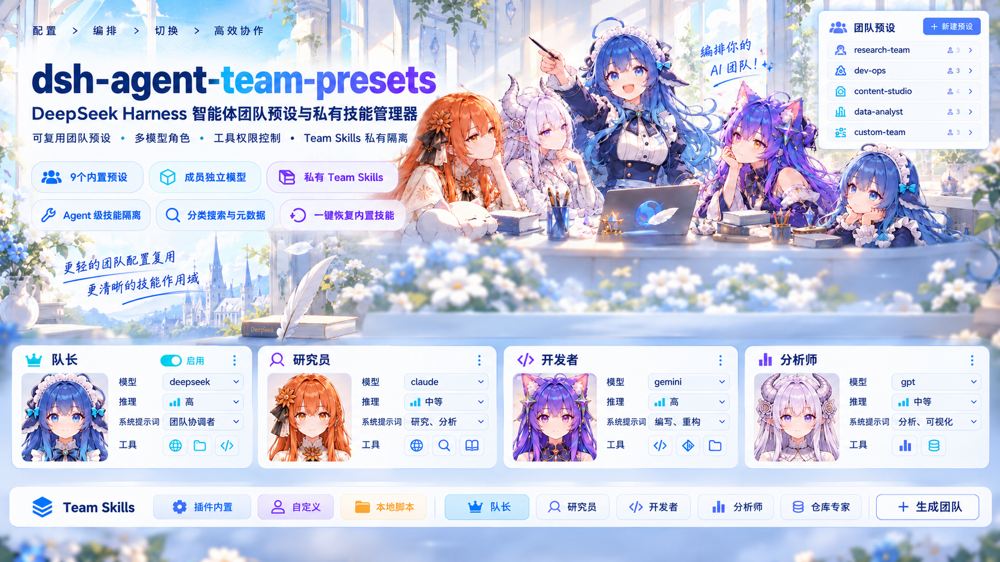

<p align="center">
  
</p>

<h1 align="center">dsh-agent-team-presets</h1>
<p align="center">为 DeepSeek Harness 提供可复用的团队预设，以及按角色隔离的私有团队技能库。</p>
<p align="center"><a href="README.md">English</a></p>

<p align="center">
  <a href="https://github.com/deepseek-ai/deepseek-harness"></a>
  <a href="https://www.typescriptlang.org/"></a>
  <a href="https://www.npmjs.com/package/dsh-agent-team-presets"></a>
  <a href="LICENSE"></a>
</p>

*横幅为概念示意；插件界面在[新手必读](docs/guide/getting-started.zh.md)里逐屏讲解；队长使用当前会话选择的模型。*

<a id="project-introduction"></a>
## 这是什么？

**dsh-agent-team-presets** 是面向 [DeepSeek Harness](https://github.com/deepseek-ai/deepseek-harness) 的可视化团队预设与私有技能管理插件。配置好一套团队后，可为各成员分配角色隔离的专属技能，并在会话输入区按需选用，无需反复设置角色。

一个团队包含一名**队长**和任意数量的**成员角色**：

- 队长使用当前会话选择的模型，并拥有独立的角色描述、系统提示词和工具策略。
- 每个成员可分别配置提供商、模型、推理强度、系统提示词、工具策略与专属 Team Skill。
- 队长通过 `spawn_team_member` 召唤成员；消息投递、执行与生命周期由 Harness 的 subagent 运行时提供。

本项目是社区插件，不是 Harness 随附的 `@deepseek-ai/dsh-experimental-agent-team-presets` 开发包。

<a id="why-this-plugin"></a>
## 为什么需要这个插件？

DeepSeek Harness 本身已提供多智能体协作的 Agent Teams；在本插件支持的版本里，按团队配置、技能隔离与复用仍留给用户自己解决：

- **团队难以复用。** 把「队长 + 各角色」存成具名预设，随时保存、复制、归类、复用，而不是每次重建角色。
- **角色配置重复。** 角色的名称、描述、系统提示词与工具策略只需配置一次。
- **跨模型分工别扭。** 每个成员各自选择模型与推理强度，队长继续使用会话当前模型主导任务。
- **工具权限缺少细粒度入口。** 队长与每个成员各带独立白名单，角色之间可以不同。
- **技能缺少按角色隔离。** 私有团队技能库只对被分配的那个 Agent 可见。
- **切换团队不方便。** 直接在会话输入区选中预设团队即可。

**设计原则：** 协作由 Harness 的 subagent 运行时负责；配置、管理、隔离与复用团队及其技能由本插件负责。

<a id="features"></a>
## 主要功能

- **可复用团队：** 新建、复制、编辑、选用与删除具名预设。
- **按成员配置模型路由：** 为单个角色指定模型与推理强度，不改变队长的模型。
- **与单个成员对话：** 在输入区选中某个成员，即把该成员的角色卡、工具策略、团队技能与模型路由注入当前会话。
- **独立工具策略：** 队长与每个成员各自可选「所有工具」或自定义白名单。
- **九个内置预设、两大系列：** 三个研发规模团队与六个工作模式团队，见[内置团队](docs/builtin-teams.zh.md)。
- **展示元数据、本地分类与搜索：** 每个团队可配置简介、标签、适用场景、推荐任务与备注——仅用于界面展示，绝不注入运行时上下文。
- **私有团队技能库：** 支持导入技能文件夹或 ZIP 包，存放在插件专属目录（`~/.dsh/agent-team-presets/team-skills`），与宿主全局技能隔离。
- **按角色隔离技能：** 成员页的三列分配网格把技能绑定到具体角色；被分配的技能**只在该 Agent 作用域内**注册。
- **十个随包团队技能：** 工作流型、交付型、方法型三类，默认绑定到内置团队各角色，支持本地副本与一键恢复；见[内置团队技能](docs/builtin-team-skills.zh.md)。
- **删除守护与依赖检查：** 仍被角色绑定、正被运行中成员使用、或被其它技能依赖时不允许删除；声明的 CLI 可执行文件会对宿主 `PATH` 校验。
- **面向智能体的工具：** `get_team_preset`、`update_team_preset`、`list_team_skills`、`assign_team_skill`、`unassign_team_skill`、`remove_team_skill`。
- **子代理卡片标签：** 在支持的目标插件里，为团队创建的子代理卡片打上「预设」标签。
- **状态与主题适配：** 查看团队是空闲、忙碌还是待更新，并适配浅色/深色模式。

<a id="quick-start"></a>
## 快速开始

### 环境要求

- **DeepSeek Harness `>=0.2.2-rc.3 <0.3.0`。** 本次实测版本为 **`0.2.2-rc.3`**；0.2.2-rc.2 及更旧版本会被拒绝。插件管理器按 [package.json](<package.json>) 的 `engines.dsh` 判定兼容性。
- **具备 Settings 与所需客户端服务的 Web 或 Desktop profile**：Web GUI 通常为 `web`，Desktop 通常为 `desktop`。
- **成员执行所需的持久存储与支持恢复执行的子智能体后端**；默认后端名为 `spawn` 和 `fork`。
- 自定义工具白名单有自己的执行模型，见[工具权限与安全](docs/reference/tools-and-permissions.zh.md)。

插件版本（`0.3.3`）和 Harness 版本（如 `0.2.2-rc.3`）是不同的版本线。

### 安装

#### 方式一 —— npm 包（推荐，会收到更新提示）

打开 **全局面板 → 插件 → 添加插件**，把下面这一行粘贴到「包名或地址」，点击 **安装**：

```text
dsh-agent-team-presets
```

<!-- release-version: 与 package.json 的 version 同步 -->

也可以用命令行安装：

```sh
dsh plugin --profile <profile> add dsh-agent-team-presets
```

GitHub 浮动安装、可复现的固定版本、安装源选择与安装说明都在[安装与升级](docs/guide/install.zh.md)。

### 确认安装

打开 **设置 → 智能体团队预设**，确认插件详情显示刚安装的版本号，且组件处于运行中状态。升级、备份，以及「不要重复声明 loader 条目」的规则见[安装与升级](docs/guide/install.zh.md)。

<a id="documentation"></a>
## 文档

README 是入口。下面每份文档都随包发布，只有图文走查是仓库专属——它引用的截图不在发布包里。

| 想了解 | 读 |
|---|---|
| 逐屏安装并用起来 | [新手必读](docs/guide/getting-started.zh.md) —— 图文教程 |
| 选择安装渠道、固定版本、安全升级 | [安装与升级](docs/guide/install.zh.md) |
| 配置团队、成员、展示元数据与分类 | [使用团队](docs/guide/using-teams.zh.md) |
| 私有团队技能库与预设分享 | [私有团队技能](docs/guide/team-skills.zh.md) |
| 打开子代理卡片标签 | [集成](docs/guide/integrations.zh.md) |
| 面向智能体的工具、工具策略与安全边界 | [工具权限与安全](docs/reference/tools-and-permissions.zh.md) |
| 排查团队、成员或安装问题 | [排障](docs/reference/troubleshooting.zh.md) |
| 参与插件本身的开发 | [架构与开发](docs/developer/architecture.zh.md) |
| 九个内置团队与角色 | [内置团队](docs/builtin-teams.zh.md) |
| 十个随包团队技能与绑定关系 | [内置团队技能](docs/builtin-team-skills.zh.md) |
| 浏览全部文档 | [文档索引](docs/index.zh.md) |

<a id="development"></a>
## 开发与贡献

源码开发需要一个兼容且已安装依赖的 [Harness 检出](https://github.com/deepseek-ai/deepseek-harness)，并先用其 `build:lib:host` 流水线生成 Host 类型与 Typert Remote 产物。完整命令、源码导航与架构说明见[架构与开发](docs/developer/architecture.zh.md)。

问题反馈与 PR 欢迎提交到 [GitHub Issues](https://github.com/bloodarea/dsh-agent-team-presets/issues) 与 [Pull requests](https://github.com/bloodarea/dsh-agent-team-presets/pulls)。

感谢 **张灏焱** 贡献 `grilling`、`research` 两个方法型团队技能（PR #2），也感谢 Matt Pocock 的上游 [skills](https://github.com/mattpocock/skills)（MIT，见 [NOTICE](<NOTICE>)）。

<a id="release-notes"></a>
## 发布说明

最新标签版本 **v0.3.2** 让同一个目标插件的多个版本同时可打补丁，并把宿主要求收紧到 **DeepSeek Harness 0.2.2-rc.3**。完整记录与产物见 [Releases](https://github.com/bloodarea/dsh-agent-team-presets/releases) 页面。

<a id="further-exploration"></a>
## 相关资源

- [DeepSeek Harness](https://github.com/deepseek-ai/deepseek-harness) —— 宿主与插件架构。
- [内置预设文档](<contrib/default-presets>) —— 随包提供的团队 JSON 定义，可直接导入。
- [随包技能文档](<assets/skills>) —— 会被物化进私有库的技能包。
- [方法型技能上游](https://github.com/mattpocock/skills) —— `grilling` 与 `research` 的来源（MIT；固定提交记录见 [NOTICE](<NOTICE>)）。

<a id="license"></a>
## 许可证

[MIT](<LICENSE>)。随包依赖的声明见 [THIRD-PARTY-NOTICES.txt](<lib/THIRD-PARTY-NOTICES.txt>)；方法型技能的来源与 MIT 署名见 [NOTICE](<NOTICE>)。
