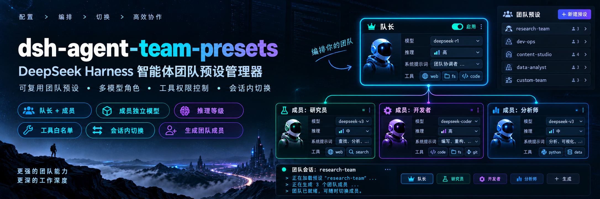

# dsh-agent-team-presets



*横幅为概念示意，实际插件界面见[界面预览](#screenshots)；队长使用当前会话选择的模型。*

[English](<README.md>) | 中文

> **社区插件 v0.1.8** · [发布版本](https://github.com/bloodarea/dsh-agent-team-presets/releases/tag/v0.1.8)
>
> 需要启用 Agent Teams 的兼容 DeepSeek Harness 部署。本版本支持 DSH rc.2 与 0.2.1-rc.2 API，详见[环境要求](#requirements)。仓库已包含预构建产物，安装时无需从源码构建。

<a id="project-introduction"></a>
## 项目介绍

**dsh-agent-team-presets** 是面向 [DeepSeek Harness](https://github.com/deepseek-ai/deepseek-harness) 的可视化团队预设与私有技能管理插件。配置好一套团队后，可为各成员分配角色隔离的专属技能，并在会话输入区按需选用，无需反复设置角色。

一个团队包含一名**队长**和任意数量的**成员角色**：

- 队长使用当前会话选择的模型，并拥有独立的角色描述、系统提示词和工具策略。
- 每个成员可分别配置提供商、模型、推理强度、系统提示词、工具策略与专属 Team Skill。
- 队长通过 `spawn_team_member` 召唤成员；消息、共享任务板和运行时协作由原生 Agent Teams 提供。

本项目是社区插件，不是 Harness 随附的 `@deepseek-ai/dsh-experimental-agent-team-presets` 开发包。

<a id="why-this-plugin"></a>
## 为什么需要这个插件？

DeepSeek Harness 原生 Agent Teams 已经具备多智能体协作能力。在本插件支持的 Harness 版本中，团队的个性化配置、技能隔离与重复使用仍由用户自己承担，这正是本插件要解决的：

- **团队难以复用**：在这些版本中，原生团队侧重运行时创建与协作，不提供可视化预设管理；本插件可保存、复制、分类管理并复用具名预设。
- **角色配置繁琐**：每个角色的名称、描述、系统提示词与工具权限配置一次即可复用，无需每次重新描述。
- **多模型分工不便**：每个成员可独立指定模型与推理强度，一个团队按任务组合不同模型；队长继续使用会话已选模型。
- **工具权限缺乏细粒度入口**：在这些版本中，原生工具面没有按角色设置的白名单；本插件让队长与每个成员各带自己的白名单，不同角色的可用范围因此不同。
- **技能缺乏角色级隔离**：随包或用户技能通常全局注册，所有智能体均可看到；本插件提供私有 Team Skill 库，技能**仅对获得分配的具体角色 Agent** 可见并生效，杜绝全局泄漏。
- **切换团队不便**：在会话输入区直接选择预设团队，不必手工重建角色。

**核心理念：** 原生 Agent Teams 负责运行时协作；本插件负责团队及其专属技能的配置、管理、隔离与复用。

<a id="features"></a>
## 主要功能

- **复用团队：** 新建、复制、编辑、选择和删除具名预设。
- **成员独立路由：** 按角色分配模型与推理强度，不改变队长的模型。
- **独立工具策略：** 为队长和各成员选择所有可用工具，或设置自定义白名单。
- **两大系列九大内置预设：** 涵盖研发规模系列（轻量研发团队、标准研发团队、全栈软件研发团队）与工作模式系列（需求探索、架构规划、既定工作流执行、工程研发协作、独立代码与安全审计、科研协作）。
- **展示元数据：** 可为团队填写简介、标签、适用场景、推荐任务与备注。纯前端展示与检索使用，**绝不注入 LLM 运行时上下文**，节省上下文 Token。
- **本地分类与检索：** 独立分类管理页支持创建、重命名、排序和删除自定义分类；支持按团队来源（全部/插件内置/自定义）与分类系列二级联动筛选，并在输入区与设置页实时全文搜索。
- **插件私有 Team Skill 库：** 支持从文件夹或 ZIP 导入技能至插件私有目录（`~/.dsh/team-skills`），与宿主全局技能完全隔离。
- **角色作用域技能隔离：** 成员编辑页提供专属技能三列卡片网格，分配给角色的技能在召唤时**严格仅在该 Agent 作用域内注册**，其他成员与队长均不可见。
- **官方内置技能与本地副本：** 随包自带两个交付技能（`github-repository-presentation`、`git-release-hygiene`）和两个方法技能（`grilling`、`research`），默认物化入库并绑定给工程、需求探索与科研角色；支持创建本地可编辑副本，支持一键「恢复为插件内置版本」，并在官方更新时显示新版本提示。
- **强阻断保护的删除机制：** 若技能仍被任一团队角色绑定、被运行中成员使用或被其它技能依赖，拒绝删除；模态弹窗直观列出所有持有者（如 `标准研发团队 → executor`）并禁用确认按钮。
- **依赖真实性检查与 MCP 边界：** 技能声明的 CLI 可执行程序会在宿主 PATH 上实际解析并标注「存在/缺失」（缺失时拒绝分配）；如实展示声明的 MCP 服务（声明式展示，不自动拉起连接，不阻断分配）。
- **面向智能体的会话工具：** 根会话提供 `list_team_skills`、`assign_team_skill`、`unassign_team_skill`、`remove_team_skill`，以及 `get_team_preset`、`update_team_preset`。
- **实时状态反馈：** 查看在线会话中的团队是空闲、忙碌，还是有修改等待采用。
- **深浅色主题适配：** 完整适配深色（Dark）与浅色（Light）模式，卡片、弹窗与九宫格均有良好对比度，无白底白字。

## 目录

- [项目介绍](#project-introduction)
- [为什么需要这个插件？](#why-this-plugin)
- [主要功能](#features)
- [界面预览](#screenshots)
- [环境要求](#requirements)
- [安装与升级](#use-this-package)
- [配置与使用团队](#configure-a-team)
- [展示元数据、本地分类与搜索](#metadata-categories-search)
- [私有团队技能与角色作用域隔离](#team-skills)
- [分享预设](#share-presets)
- [面向智能体的工具](#agent-facing-tools)
- [工具权限与安全边界](#tool-permissions)
- [排障与使用限制](#known-limitations-and-deferred-work)
- [工作原理](#understand-the-implementation)
- [开发与贡献](#development)
- [相关资源](#further-exploration)
- [许可证](#license)

<a id="screenshots"></a>
## 界面预览

以下截图展示 v0.1.8 设置页团队管理、私有技能库与输入区选用流程。模型与工具取决于你的实际部署。

**管理已保存的团队：标签页、搜索框、来源与系列筛选**


**在会话输入区选择团队：支持搜索与来源筛选**


**私有 Team Skill 技能库：来源色标与操作入口**


**为成员角色分配专属 Team Skill**


**技能详情：文件树、内容预览与本地副本管理**


**带持有者列表的技能删除强阻断弹窗**


**管理团队预设自定义分类**


**团队编辑页：展示元数据、分类选择与状态提醒**


<details>
<summary>更多设置截图（模型路由、下拉交互、系统提示词与工具策略）</summary>

**团队编辑页中的分类下拉弹层**


**筛选自定义来源的团队**


**配置成员模型与推理强度**


**模型选择器**


**队长与成员系统提示词**


**工具策略控件**


</details>

<a id="requirements"></a>
## 环境要求

- **具备所需 rc.2 API 的 DeepSeek Harness。** 支持版本：`>=0.2.0-rc.2 <0.3.0`。插件管理器按声明的 `engines.dsh` 范围判定，超出即拒绝安装或激活；`@deepseek-ai/dsh-*` 的 peer 范围供包管理器使用，该判定不读取它们。本版本实测环境为 **`0.2.1-rc.2`**；0.1.8 未在 `0.2.0-rc.2` 上复验。详见 [package.json](<package.json>)。
- **目标 profile 已启用 Agent Teams。** 标准集成是 `@deepseek-ai/dsh-experimental-agent-team-profile`，提供团队服务、工具和 Web 名册。本插件负责配置与管理团队，不替代该子系统。
- **具备 Settings 与所需客户端服务的 Web 或 Desktop profile。** 安装到实际使用的 profile：Web GUI 通常为 `web`，Desktop 通常为 `desktop`。
- **成员执行所需的持久存储与支持恢复执行的子智能体后端。** 缺少 storage domain 或所选执行后端时，插件会拒绝创建成员。默认后端名为 `spawn` 和 `fork`。

插件版本（`0.1.8`）和 Harness 版本（如 `0.2.1-rc.2`）是不同的版本线。

<a id="use-this-package"></a>
## 安装与升级

### 在 GUI 中一键安装（添加插件）

打开 **全局面板 → 插件 → 添加插件**，把下面这一行粘贴到「包名或地址」，点击 **安装**：

```text
dsh-agent-team-presets@0.1.8
```

<!-- release-version: 与 package.json 的 version 同步 -->

- **安装源**决定从哪个 npm 源下载。「默认安装源」指 pnpm 自身配置所指的源。要绕开镜像选「npm 官方源」；要换内网私有源或云厂商镜像选「自定义地址」。
- `@0.1.8` 指定版本；想装 npm 上最新的已发布版本，去掉它只填 `dsh-agent-team-presets`。
- 输入框支持包名、`name@version`、`github:作者/仓库`、tarball 地址或本地绝对路径。
- 本包声明了自己的 `dsh.bundle`，安装后由插件管理器登记为 profile 的 bundle 层，不要再手写 loader 条目。
- 已安装本包时无法重复安装同一包名。要更换安装来源（如由 GitHub 改为 npm），先在插件列表中卸载，再粘贴新规格安装。
- 安装完成后按提示重新加载或重启应用。

### 从 GitHub 安装

需要接收仓库新版本更新提示时：

```sh
dsh plugin --profile <profile> add github:bloodarea/dsh-agent-team-presets
```

将 `<profile>` 替换为实际运行的 profile（例如 `web` 或 `desktop`）：

```sh
dsh plugin --profile web add github:bloodarea/dsh-agent-team-presets
```

需要固定 v0.1.8 发布标签时：

```sh
dsh plugin --profile <profile> add github:bloodarea/dsh-agent-team-presets#v0.1.8
```

### npm 发布渠道

GitHub 与 [npm](https://www.npmjs.com/package/dsh-agent-team-presets) 是独立发布渠道。从 npm 安装前先确认已发布版本：

```sh
npm view dsh-agent-team-presets version
dsh plugin --profile <profile> add dsh-agent-team-presets
```

### 确认安装并安全升级

安装成功后，按插件管理器的提示重新加载或重启，打开 **设置 → 智能体团队预设**。确认插件详情显示 `dsh-agent-team-presets`、版本 `0.1.8`，且组件处于运行中状态。

- 升级前备份 profile 设置、团队定义与会话选择记录。
- 从开发链接迁移时，先通过插件管理器移除 `@deepseek-ai/dsh-experimental-agent-team-presets`，再启用社区包。
- 切换包身份后重启 Harness，再刷新 GUI。

> **安装 bundle，不要再声明一份 loader 条目。** 本包已经提供[自己的 bundle patch](<cordis.patch.yml>)。在 profile、home 或命令行 patch 中手写重复的 `agent-team-presets` 条目，可能导致设置无法保存。遇到此问题请参阅[配置写入被覆盖](#configuration-overridden)。

<a id="configure-a-team"></a>
## 配置与使用团队

1. 打开 **设置 → 智能体团队预设**。
2. 选择内置团队、复制已有团队，或点击 **新建团队**。
3. 设置团队名称、用途、展示元数据、所属分类、队长与成员角色。
4. 为各成员配置独立的模型路由、推理强度、工具权限与专属 Team Skill。
5. 点击共享页脚中的 **保存**。未保存前的修改均为草稿。
6. 在会话输入区的团队选择器中选中该团队，要求队长调度角色完成任务。

例如针对包含研发与审查角色的团队：

> 使用当前团队。让研发执行者完成约定改动并补全回归测试，再让独立审查员进行质量检查。最后汇总改动、测试结果与剩余风险。

预设角色是召唤模板。每次召唤会创建带唯一 target（如 `executor` 或 `executor-2`）的实例。需要继续已有成员工作时，使用 `send_message` 发向返回的 target，而不是重新创建实例。

选择 **不使用团队（No team）** 会在队长与队员全部空闲后卸载团队应用，恢复常规会话行为，不改变已选模型。

### 字段说明

| 字段 | 用途 |
|---|---|
| 团队名称与用途 | 标识预设，并说明适合处理什么工作。 |
| 所属分类 | 归入自建分类，便于在列表与选择器中归纳。 |
| 展示元数据 | 简介、标签、适用场景、推荐任务与备注。仅供界面展示与检索，不注入 LLM 运行时上下文。 |
| 队长 | 当前会话的主智能体。非空的队长提示词会替换其 persona 前缀；队长使用会话当前模型。 |
| 成员 | 队长可召唤的角色模板。 |
| 名称 | 角色显示名称与 target 基础。ASCII 字母/数字/连字符（最多 64 字符，不能为 `lead`）。 |
| 描述 | 说明角色职责，供队长选人决策（建议 200 字符以内）。 |
| 颜色 | 在设置页和名册中区分角色的强调色。 |
| 提供商 / 模型 | 仅成员可配置。从部署的模型目录中独立选择路由。 |
| 推理强度 | 仅成员可配置。取决于模型支持，留空使用路由默认值。 |
| 允许的工具 | 独立配置所有工具或自定义白名单策略。 |
| Team Skills | 专属技能分配。成员被召唤时，仅在该 Agent 作用域内注册生效。 |
| 系统提示词 | 固定的角色指令。完整的 `{{variable}}` 会作为模板变量处理。 |

### 内置预设

全新安装会初始化九个可编辑的团队，划分为两大系列：

#### 研发规模系列 (Classic Development Scale)

| 预设 | 包含角色 | 适用场景 |
|---|---|---|
| **轻量研发团队**<br>`builtin-lightweight` | 队长 (`team-lead`)、全栈顾问 (`fullstack-advisor`)、研发执行者 (`executor`) | 适合小型功能与模块迭代。队长划分任务并验收，架构顾问按需提供跨层技术方案与契约，研发执行者承担编码、调试、测试与修复。预绑定官方交付技能。 |
| **标准研发团队**<br>`builtin-standard` | 队长 (`team-lead`)、系统架构师 (`system-architect`)、研发执行者 (`executor`)、独立代码审查员 (`code-reviewer`) | 适合标准软件项目。队长调度，系统架构师确立模块边界与接口契约，执行者开发与测试，独立代码审查员在交付前把控质量。预绑定官方交付技能。 |
| **全栈软件研发团队**<br>`builtin-fullstack` | 队长 (`team-lead`)、后端架构师 (`backend-architect`)、UI 设计师 (`ui-designer`)、研发执行者 (`executor`)、独立审查员 (`reviewer`) | 面向 Web、桌面与 Android 跨端复杂工程。队长调度，架构师与设计师制定方案与交互契约，执行者跨层实施，独立审查员严格把控交付标准。预绑定官方交付技能。 |

#### 工作模式系列 (Work Modes)

| 预设 | 包含角色 | 适用场景 |
|---|---|---|
| **需求探索**<br>`builtin-discovery` | 队长、需求挖掘专家、方案探索者、独立质疑者 | 新想法，目标、技术路径或产品方向尚未确定；默认只读调研，并配有独立质疑。 |
| **架构规划**<br>`builtin-planning` | 队长、架构设计专家、技术选型评估者、风险合规审计员 | 目标已明确，但系统结构、模块边界与跨模块契约仍需深入设计与评审。 |
| **既定工作流执行**<br>`builtin-workflow` | 队长、流程调度专家、任务执行者、成果验收员 | 项目已有成熟方案：由用户点名本次任务，团队负责流水线实施、验证与交付。 |
| **工程研发协作**<br>`builtin-engineering` | 队长、架构顾问、研发执行者、代码审查员、仓库交付专家 (`repository-specialist`) | 功能开发、跨层实现、UI/UX 与调试，配有专门负责规范与 Release 交付的专家角色。预绑定官方交付技能。 |
| **独立代码与安全审计**<br>`builtin-audit` | 队长、漏洞分析专家、代码安全审计员、依赖合规检查员 | 对指定代码、安全漏洞、配置或依赖合规做独立只读审查。 |
| **科研协作**<br>`builtin-research` | 队长、领域调研专家、实验与数据分析员、学术严谨性审查员 | 文献综述、实验设计、科学计算、数据分析与学术严谨性论证。 |

内置预设在每个 profile 中只初始化一次。用户对其编辑或删除会被持久记忆。**恢复默认预设** 会重置内置字段与角色，但完整保留匹配角色的模型路由与工具策略。

<a id="metadata-categories-search"></a>
## 展示元数据、本地分类与搜索

### 纯前端展示元数据

每个预设均支持完整的展示元数据：
- **简介 (Summary)**：卡片与选择器中展示的一句话定位。
- **标签 (Tags)**：用于快速分类与检索的关键词。
- **适用场景 (Use Cases)**：适合该团队的项目与工作类型。
- **推荐任务 (Quick Prompts)**：选中该团队后展示的推荐快捷任务。
- **备注 (Notes)**：协作注意事项或说明。

**Token 保护：** 展示元数据保存在预设文档中，仅在界面与检索中展示，**绝不注入 LLM 运行时提示词中**，不占用任何模型上下文。

### 本地分类与层级筛选

- **分类管理页：** 点击设置列表中的 **管理团队预设分类** 即可进入独立管理页。支持新建分类、重命名、上下移动排序以及删除分类，清晰显示每个分类下的团队数量。
- **本地隔离：** 分类与团队分类归属仅保存在当前 profile 本地，导出预设时**绝不会随文件导出**。
- **双排联动筛选：**
  - **来源 (Source)：** 全部、插件内置、自定义。
  - **分类 (Category)：** 针对内置团队显示研发规模与工作模式两大系列；针对自定义团队显示用户自建分类，互斥切换。
- **实时搜索：** 输入关键词即时全文检索名称、简介、标签、适用场景与推荐任务，并实时显示匹配数量。
- **输入区联动：** 会话输入区的团队选择器完全镜像支持上述来源筛选与搜索能力，并将 `不使用团队` 固顶在最上方。

<a id="team-skills"></a>
## 私有团队技能与角色作用域隔离

### 私有库存储与严格作用域隔离

传统 Harness 技能一般注册到全局环境，所有智能体均可看到。本插件开创性地实现了 **Team Skill 私有技能子系统**：

1. **私有存储库：** 技能统一存放在插件专属目录（`~/.dsh/team-skills` 或独立存储域），不污染宿主全局技能列表。
2. **角色 Agent 作用域隔离：** 成员被队长召唤时，其绑定的专属技能**严格仅在该成员的 Agent Scope 内注册**。其他队员和队长既无法看到、也无法调用该技能。
3. **官方内置技能：** 随包提供 4 个内置技能——交付型 `github-repository-presentation`、`git-release-hygiene`，方法型 `grilling`（先澄清再动手）与 `research`（只认一手来源）。默认绑定：工程团队的 `executor`/`repository-specialist` 获得交付技能；需求探索队长获得 `grilling`，其 `technical-scout`/`product-scout` 与科研协作 `evidence-scout` 获得 `research`。
4. **本地副本与一键恢复：** 内置技能默认只读，支持一键「创建本地可编辑副本」修改文件。插件版本升级时会自动提示 `updateAvailable`，支持随时「恢复为插件内置版本」。
5. **清晰的来源色标：**
   - 插件内置（Built-in，蓝色）
   - 自定义（Custom，紫色）
   - 本地副本（Override，琥珀色）

### 导入、目录扫描与依赖守护

- **文件夹与 ZIP 导入：** 支持在前端直接导入外部技能文件夹或 `.zip` 压缩包。
- **目录扫描检测：** 扫描导入目录下的子文件夹，逐个检查有效性并给出拒绝原因；支持一键复制私有库绝对路径。
- **依赖检查与 MCP 边界：**
  - **CLI 可执行程序：** 按宿主 `PATH` 查找 `SKILL.md` 声明的命令行工具，Windows 同时遵循 `PATHEXT`；目录和不可执行文件不能满足依赖。缺失时标记并在分配时阻断（`dependency-missing`）。
  - **MCP 服务边界（声明式展示，不自动拉起）：** 技能声明的 MCP 服务仅作依赖声明与信息展示，插件**不会自动拉起、配置或连接**外部 MCP 服务（MCP 服务的生命周期由宿主环境与 Profile 决定）。由于 MCP 服务连接状态属于宿主环境级事实，插件将其如实标记为 `unverified`（未核实）进行提示，而不会在私有库层强行阻断角色分配。若宿主环境中已接入相应 MCP 服务，其提供的工具将在成员工具配置的 MCP 分组下可见并可通过工具策略勾选授权。
- **强阻断保护的删除：** 技能只要被任何团队角色分配、被活跃成员占用或被其它技能依赖，删除即被强阻断。删除弹窗会完整列出所有阻断持有者（如 `标准研发团队 → executor`），此时确认删除按钮强制置灰禁用。

<a id="share-presets"></a>
## 分享预设

**导出** 将一个团队保存为 JSON 文档（格式版本 2）。**导入预设** 读取文档并暂存到编辑器中。

- **分享的字段：** 团队名称、用途、展示元数据（简介、标签、适用场景、推荐任务、备注），以及队长和成员的名称、描述、提示词、颜色。
- **本地字段：** 模型路由、推理强度、工具权限与本地分类归属**绝不导出**；携带此类字段的导入文档会被拒绝。
- **名称冲突：** 自由选择覆盖替换已有预设或改名新建。覆盖替换会保留原有角色的本地模型路由与工具策略。
- 导入来自第三方的预设前，请仔细核对其提示词与权限。

<a id="agent-facing-tools"></a>
## 面向智能体的工具

根会话注册了一组面向智能体的工具，在受工具策略允许时，队长智能体可直接查询或维护预设及技能：

### 预设管理工具

- **`get_team_preset`**：读取指定或当前选中的团队预设，返回可编辑字段、成员配置及设置修订号。
- **`update_team_preset`**：使用 CAS 修订号更新团队/队长描述及成员提示词/描述（需用户直接发起并由 Host 审批确认）；若相关成员正在执行则返回 `team-busy`。

### 团队技能工具

- **`list_team_skills`**：列出私有库中已安装的技能、来源、依赖项及角色分配状态。
- **`assign_team_skill`**：为某个团队的角色分配一个 Team Skill（作用域限定在该 Agent）。
- **`unassign_team_skill`**：解除角色的 Team Skill 分配。
- **`remove_team_skill`**：从私有库删除 Team Skill（受阻断规则保护）。

<a id="tool-permissions"></a>
## 工具权限与安全边界

### 策略模式

- **默认所有工具**：不增加额外白名单限制。
- **自定义可用工具**：仅允许选中的工具。协作工具（`send_message`、`list_agents`、`team_task_*`）如需使用必须显式勾选。
- 队长与成员策略完全独立。
- **`skill` 工具始终放行，且不作为可选项呈现。** 它只负责发布技能目录并加载指令文本，不授予能力；而宿主会把整个目录从看不到该工具的角色那里收起。因此自定义白名单无法移除它，设置页也不再列出它——一个永远不会生效的勾选框只会误导使用者。旧版本写入、仍包含该项的配置照常加载：该名字被隐式放行，不会被提示为"不可用"，也不需要手动删除。

### 成员首轮能保证什么

已分配的 Team Skill 只有在成员真正发问的那一轮能被加载才有意义，因此插件把注册放进成员创建流程，而不是留给后台：

- **成员**：创建边会等待该 Agent 自己的注册完成后才结束。角色持有已分配的 Team Skill、但本次部署无法发布它时（未组合技能服务、私有库不可读、注册被拒），创建会被**明确拒绝**并给出原因，而不是在空目录下启动、让所有界面仍显示"已分配"。没有任何分配的角色，在未组合技能服务的部署上照常创建。
- **队长**：同一注册在 Session 创建边、依赖的 Team 应用之后完成。队长分配发布失败不会拒队——已在运行的 Session 不能因此失去能力策略——失败会以该 Agent 身份被报告出来。
- **"库不可读"不等于"库为空"。** 私有库打不开时，插件无法枚举任何角色的绑定，因此按"不可知"拒绝成员创建，而不是把未知当成"没有分配"。修复库路径（或重新开始）即可恢复。

### 已知限制：Windows 验证

路径分隔符与可执行文件解析的修复由归一化分隔符的单元测试和 `ENOTDIR` 用例覆盖，但本次没有可用的 Windows 机器。跨盘符 junction、真实 `PATH` 上的 `PATHEXT` 解析以及完整原生构建链仍需在 Windows 上跑一遍，才能称该版本"已通过 Windows 验证"。

### 安全边界

- 白名单**不是文件系统或网络沙箱**。允许 bash 等具备执行能力的工具仍具备其原生系统能力。
- 自定义策略模式禁止通用 `run_code` 和普通 `subagent` / `workflow` 委派，确保持久策略契约。
- 受管成员恢复时必须能读取其持久配置。记录缺失或损坏时严正拒绝，杜绝回退为不受限默认状态。

<a id="known-limitations-and-deferred-work"></a>
## 排障与使用限制

<a id="configuration-overridden"></a>
### 配置写入被覆盖

若保存或选择团队时报：

```text
Configuration for "agent-team-presets" is overridden by a home patch or command-line overlay
```

请检查 profile patch、`$DSH_HOME/cordis.patch.yml` 和 `--patch` 中是否有重复的手写 `agent-team-presets` 声明。移除重复项并保留 Host 管理的设置行。

### 常见问题

| 现象 | 排查方向 |
|---|---|
| 看不到设置页或插件处于 pending | 检查 profile 类型、peer 依赖兼容性、Agent Teams 是否启用及客户端服务。 |
| 技能删除按钮置灰不可点击 | 技能受保护：查看弹窗中的阻断列表，需先在对应团队角色中取消分配。 |
| 技能分配被拒绝 (`dependency-missing`) | 技能声明的某个必需命令行程序在宿主 `PATH` 上未找到。注意声明的 MCP 服务仅供展示参考，不阻断分配；如需使用请确认 profile 中已正确配置并连接对应 MCP。 |
| 成员创建被拒绝 | 检查持久存储、执行后端（`spawn`/`fork`）、模型配额及并发限额。 |
| 成员显示的模型与配置不一致 | 在 Harness rc.2 中，`list_agents.model` 读取 fallback 元数据。实际路由以 `spawn_team_member` 返回的 `configuredRoute` 或会话请求日志为准。 |

<a id="understand-the-implementation"></a>
## 工作原理

插件通过 Cordis 与 Harness 生命周期扩展点深度协作，无需修改宿主源码：

1. **Profile 配置：** 保存团队预设、展示元数据、本地分类与活动会话选择。
2. **会话应用：** 在 Agent 作用域安装队长 persona、工具策略和 `spawn_team_member`。
3. **成员创建与技能注入：** 校验路由与委派配额，保存持久快照并召唤子会话。串行 `agent/created` 钩子在首次请求前，将模型路由、persona、工具白名单以及**专属 Team Skill 严格注入该成员的 Agent 作用域**。
4. **私有技能管理器：** 负责技能目录存储（`~/.dsh/team-skills`）、防崩溃事务日志、依赖解析与删除阻断核验。

### 源码导航

| 范围 | 源码 |
|---|---|
| 插件生命周期与设置协调 | [src/index.ts](<src/index.ts>)、[src/settings-reconcile.ts](<src/settings-reconcile.ts>) |
| 内置预设目录与系列 | [src/builtin-teams.ts](<src/builtin-teams.ts>)、[src/team-catalog.ts](<src/team-catalog.ts>) |
| 团队应用与成员召唤 | [src/application.ts](<src/application.ts>) |
| 成员快照与运行时注入 | [src/member-store.ts](<src/member-store.ts>)、[src/member-identity.ts](<src/member-identity.ts>)、[src/member-runtime.ts](<src/member-runtime.ts>) |
| 私有 Team Skill 技能子系统 | [src/team-skills/store.ts](<src/team-skills/store.ts>)、[src/team-skills/manager.ts](<src/team-skills/manager.ts>)、[src/team-skills/service.ts](<src/team-skills/service.ts>)、[src/team-skills/tools.ts](<src/team-skills/tools.ts>) |
| 工具策略与呈现方式 | [src/tool-policy.ts](<src/tool-policy.ts>)、[src/presentation.ts](<src/presentation.ts>) |
| 预设工具与导入导出 | [src/preset-tools.ts](<src/preset-tools.ts>)、[src/preset-transfer.ts](<src/preset-transfer.ts>) |
| 浏览器前端界面 | [src/client/](<src/client/>) |

<a id="development"></a>
## 开发与贡献

源码开发需要一份兼容、已安装依赖的 [Harness 源码](https://github.com/deepseek-ai/deepseek-harness)，并先完成其 Host 类型与 Typert Remote 产物生成（Harness 的 `build:lib:host` 流程提供这些前置产物）：

```sh
export DSH_CHECKOUT=/absolute/path/to/deepseek-harness
npm test
npm run typecheck
npm run bundle
```

欢迎通过 [GitHub Issues](https://github.com/bloodarea/dsh-agent-team-presets/issues) 和 [Pull requests](https://github.com/bloodarea/dsh-agent-team-presets/pulls) 反馈问题与贡献修改。

感谢 **张灏焱** 贡献 `grilling` 与 `research` 两个方法型 Team Skill（PR #2），以及 Matt Pocock 提供其改编所依据的上游 [skills](https://github.com/mattpocock/skills)（MIT，见 [NOTICE](<NOTICE>)）。

<a id="further-exploration"></a>
## 相关资源

- [DeepSeek Harness](https://github.com/deepseek-ai/deepseek-harness) —— 宿主与插件系统。
- [内置预设文档](<contrib/default-presets>) —— 九大团队的 JSON 定义副本，可供查阅或自定义导入。
- [随包技能文档](<assets/skills>) —— 物化入私有库的官方技能 `SKILL.md` 目录。
- [方法技能上游](https://github.com/mattpocock/skills) —— `grilling` 与 `research` 的原文来源（MIT，固定 commit 见 [NOTICE](<NOTICE>)）。
- [GitHub Releases](https://github.com/bloodarea/dsh-agent-team-presets/releases) —— 已发布版本。

<a id="license"></a>
## 许可证

[MIT](<LICENSE>)。随包第三方依赖许可见 [THIRD-PARTY-NOTICES.txt](<lib/THIRD-PARTY-NOTICES.txt>)；随包方法技能的来源与 MIT 许可见 [NOTICE](<NOTICE>)。
