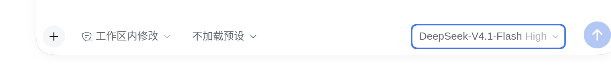
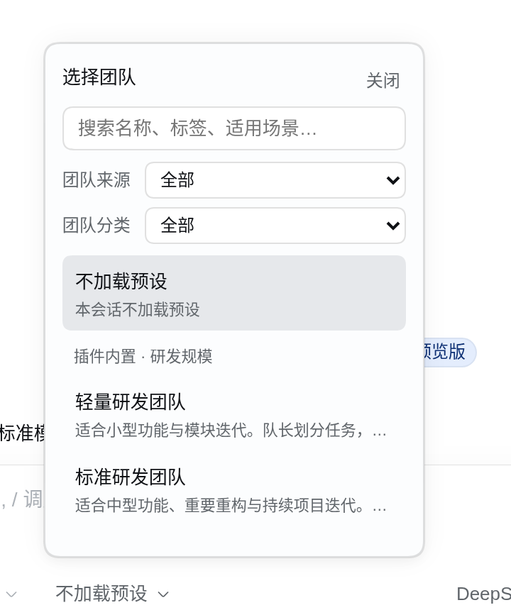
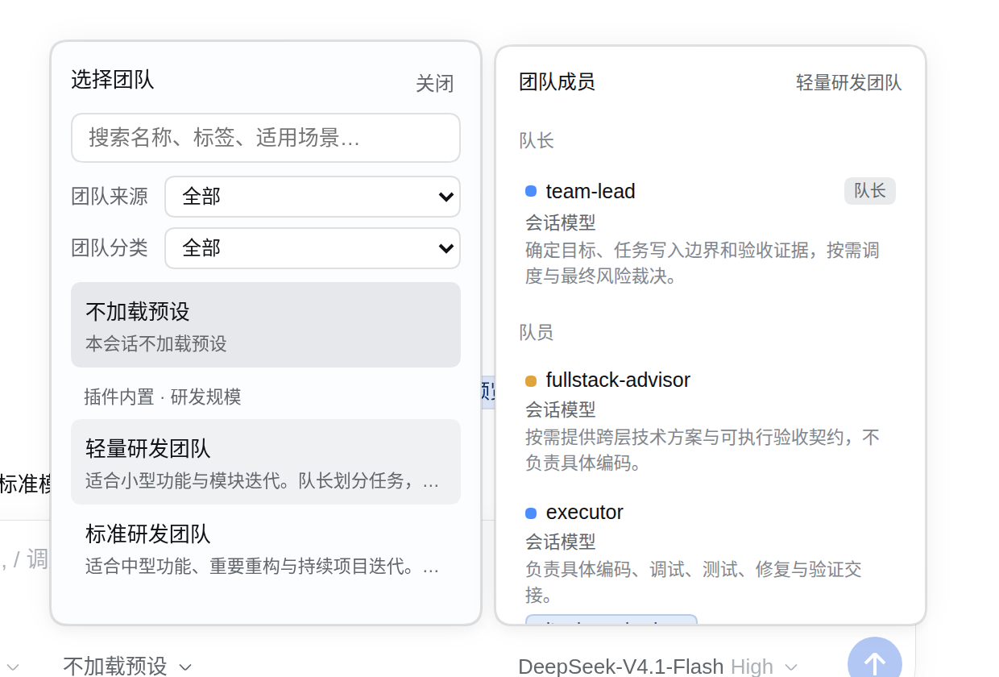
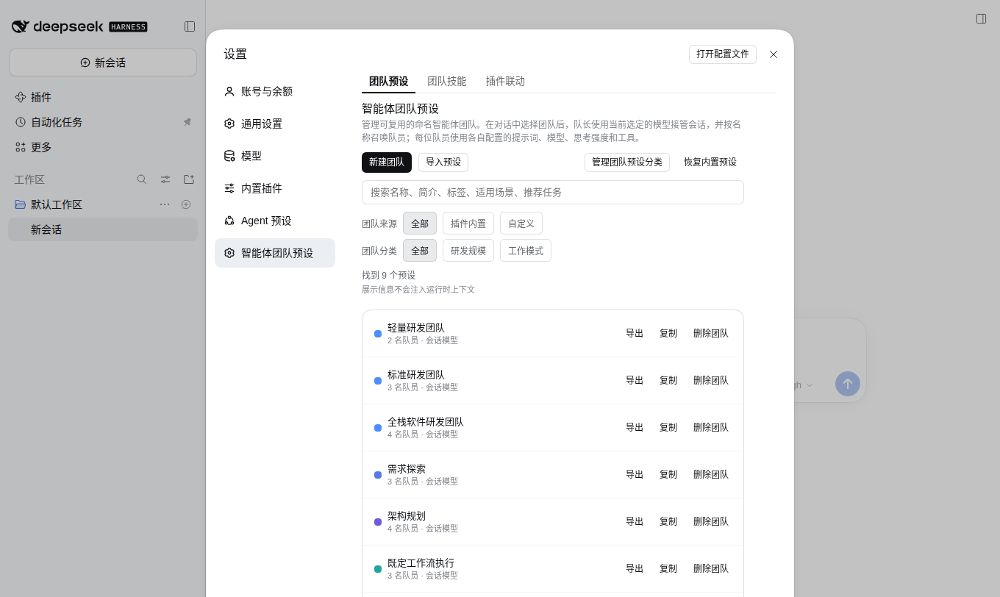
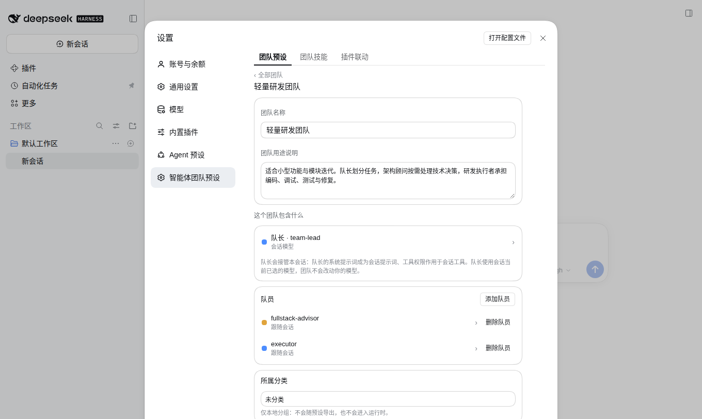
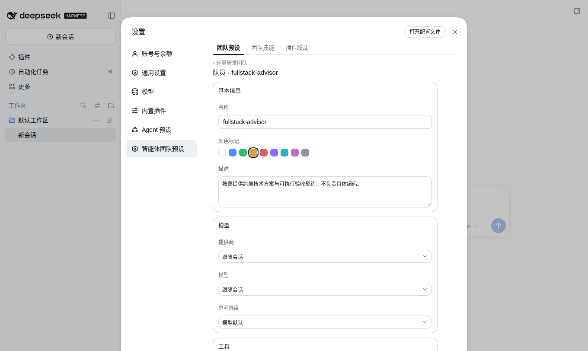
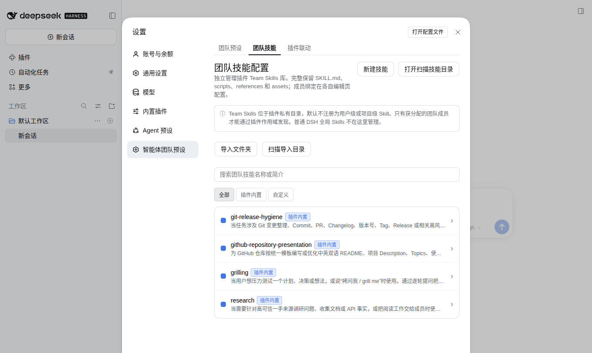
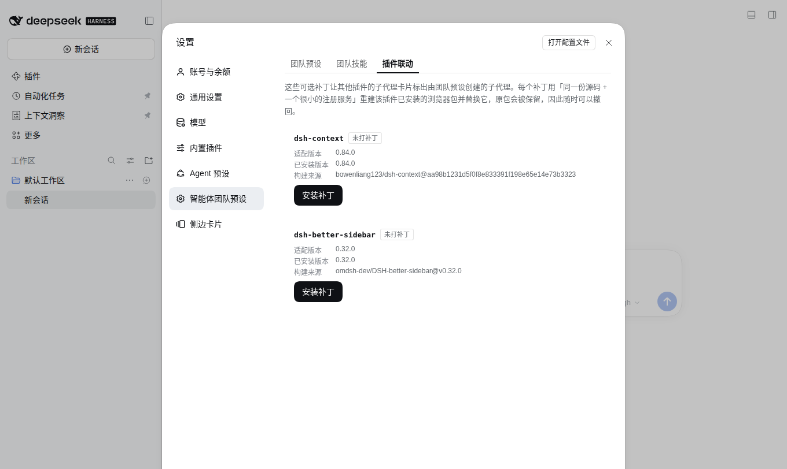
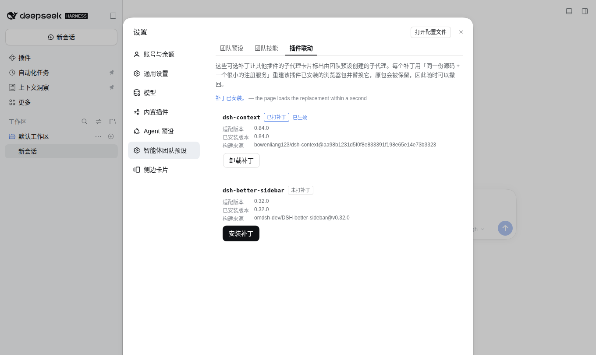

# New here? Start with this guide

This walkthrough assumes you have **never used this plugin**. Follow it once and you will know where every control is and what happens when you use it.

> All screenshots come from an isolated instance with only this plugin installed (default workspace, nine built-in Teams), so no personal Sessions or custom content appear. Your own menus will list more entries — those come from other plugins.

---

## 1. What the plugin gives you

In one sentence: **it saves "a captain plus members that each carry their own model and tool permissions" as a reusable preset you switch on inside a conversation.**

After installing it you get three surfaces:

| What you see | Where | What it does |
| --- | --- | --- |
| The `No preset` dropdown | Bottom-left of the composer | Pick a Team for the current Session |
| The "Agent Team presets" settings page | Settings → left navigation | Create, edit, import and export Teams |
| The "Team" button | Conversation header (appears once a Team is selected) | Roster plus shared task progress |

---

## 2. Pick a Team in the conversation

First check that the switch on the right of the composer is on: open the model menu and look at the last row, **"Enable agent team collaboration"**. It decides whether this Session may use Teams at all; while it is off, the Team entry point stays hidden.

See `No preset ⌄`? Click it.

The panel contains:

- a **search box** that matches Team names, tags and use cases;
- **source** filters: built-in or custom;
- **category** filters: development scale, work modes, and your own groups;
- the list itself — each row is "Team name + one-line summary"; the first row, `No preset`, returns the Session to Team-less mode.

**To choose**, click a row. The Session switches to that Team immediately and the composer shows its name.

---

## 3. See who is on the Team

**Hover** a Team row (no click needed) and the member panel opens on the right:

The panel has two sections:

- **Captain** (`team-lead`): it takes over this Session — its system prompt becomes the Session prompt and its tool policy governs Session tools. The captain always runs on the model you already selected; a Team never silently changes your model.
- **Members**: each row shows the model that member runs on (`Session model` means it follows the Session) and what it is responsible for.

Clicking a member row switches you into a one-to-one conversation with that member instead of leaving the captain to dispatch — useful when you want to direct one role yourself.

---

## 4. Manage Teams: the settings page

Open **Settings → "Agent Team presets"** in the left navigation:

The three tabs at the top are the whole plugin:

| Tab | Contents |
| --- | --- |
| **Team presets** | Team list, create, import/export, categories |
| **Team skills** | The private skill library, assigned per role |
| **Integrations** | Optional patches that add a `Preset` tag to other plugins' subagent cards |

Each row has **Export / Duplicate / Delete**. Above the list:

- **New Team** — start from blank;
- **Import preset** — read a JSON document someone shared;
- **Manage categories** — create, rename, reorder, delete your own groups;
- **Restore defaults** — put the nine built-in Teams back to their shipped content (your own model routes and tool policies are preserved).

Click **Save** when you are done, or **Discard changes** to leave the page untouched.

---

## 5. Edit a Team

Click any row in the list to open the Team editor:

From top to bottom:

1. **Team name / purpose** — the purpose appears in the picker and feeds search;
2. **Captain · team-lead** — open it to edit the captain's role description, system prompt and tool policy;
3. **Members** — one row per role, with a delete control and an **Add member** button;
4. **Category** — local grouping only; it is never exported and never reaches the runtime;
5. **Display metadata** — summary, tags, use cases, quick prompts, notes. **This part is never injected into the model context**; it exists for display and search, so write freely.

### A member page: model route and tool permissions

Click a member:

- **Identity**: name, colour mark (used by the roster), description;
- **Model**: provider, model, reasoning effort. All default to `Follow session`; picking a concrete model pins that member to it, without touching the captain;
- **Tools**: inherit everything the deployment offers, or switch to a custom allow-list so this role only reaches what it needs;
- **System prompt**: the role's own instructions;
- **Assigned skills**: bind Team Skills to this role only (next section).

---

## 6. Team skills: skills that belong to one role

Switch to the **Team skills** tab:

This is a **plugin-private skill library**, separate from the deployment's global skills:

- **Import folder / Scan import directory / New skill** brings a `SKILL.md` together with its `scripts`, `references` and other assets;
- **Built-in / Custom** — four shipped skills (`git-release-hygiene`, `github-repository-presentation`, `grilling`, `research`) are marked as built-in and can be duplicated into editable local copies;
- click a row to read it, check its declared dependencies and see **where it is bound**.

The rule that matters: a skill is visible to **only the role it was assigned to**. Assignment happens on the member page's "Assigned skills" section, not here — this page only owns the library.

---

## 7. Integrations: the `Preset` tag on other plugins' cards

New in 0.3.0. This is the one page that modifies **another plugin's installed files**, which is why every step asks you to confirm.

Each row is one target plugin and shows four facts: the version this build patches, the installed version, the upstream revision the replacement was built from, and the current state.

- `Not patched` → an **Install patch** button;
- `Patched` → a **Remove patch** button;
- `Not installed` / `Version not supported` / `Modified by something else` → the reason only, with no button (it refuses rather than guessing).

Installing asks for confirmation first, naming the package, the file and the supported version. Afterwards:

`Patched` plus **active** means it worked. **No `dsh web` restart and no page reload are needed** — the running server republishes that plugin's browser bundle and the page reloads it in place, so the tag appears within about a second.

Once installed, subagents a Team created carry a `Preset` tag on their dsh-context Fleet card and on their dsh-better-sidebar task card. Ordinary subagents do not.

> Safety: the original file is backed up before it is replaced, and removing the patch restores it and deletes the backup. Installation is only allowed when the target still holds the **published bytes**; anything already edited by someone else is refused.

---

## 8. Summon members and watch the work

With a Team selected, just send your task to the captain. It calls `spawn_team_member` when it needs help, and every member starts with its own model, prompt, tool allow-list and assigned skills.

The conversation header then shows a **Team** button: the captain plus every summoned member (with live status and the model each runs on), and below it the shared task board — each task with its status, dependencies, write scopes and description. Clicking a member jumps to that member's conversation.

---

## 9. Troubleshooting

| Symptom | Cause and fix |
| --- | --- |
| No Team entry in the composer | "Enable agent team collaboration" in the model menu is off |
| Selected a Team but the captain behaves the same | A Team is adopted at the Session's next task boundary; a running task is never rewritten mid-flight |
| A member uses the Session model instead of mine | Its provider/model is still `Follow session`; pick a concrete model |
| A Team Skill does nothing for a role | Skills are bound **per role**; assign it on the member page's "Assigned skills" |
| Integrations says "Version not supported" | The target plugin changed version; this build only ships a replacement for the pinned one |
| No tag after installing the patch | That card's subagent was not created by a preset; only preset-created members carry the tag |

For release history see [GitHub Releases](https://github.com/bloodarea/dsh-agent-team-presets/releases).
