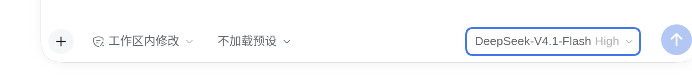
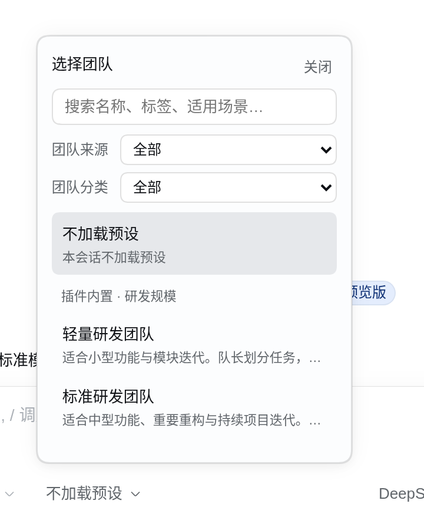
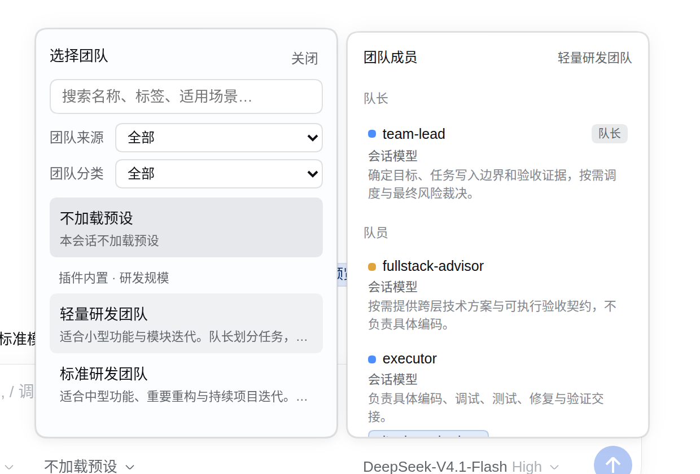
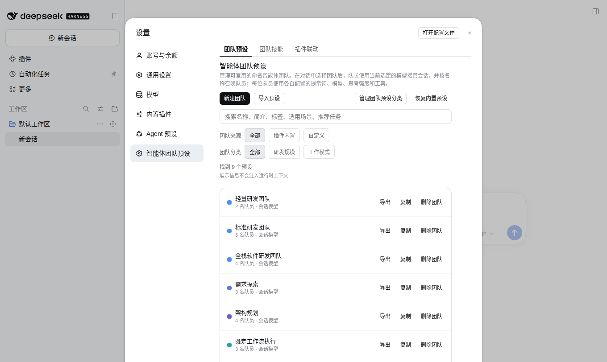
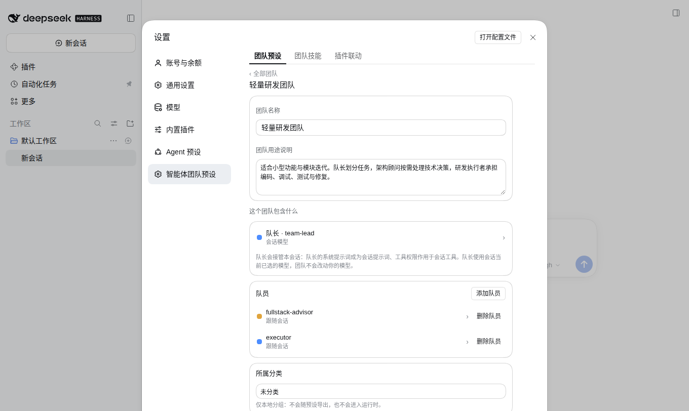
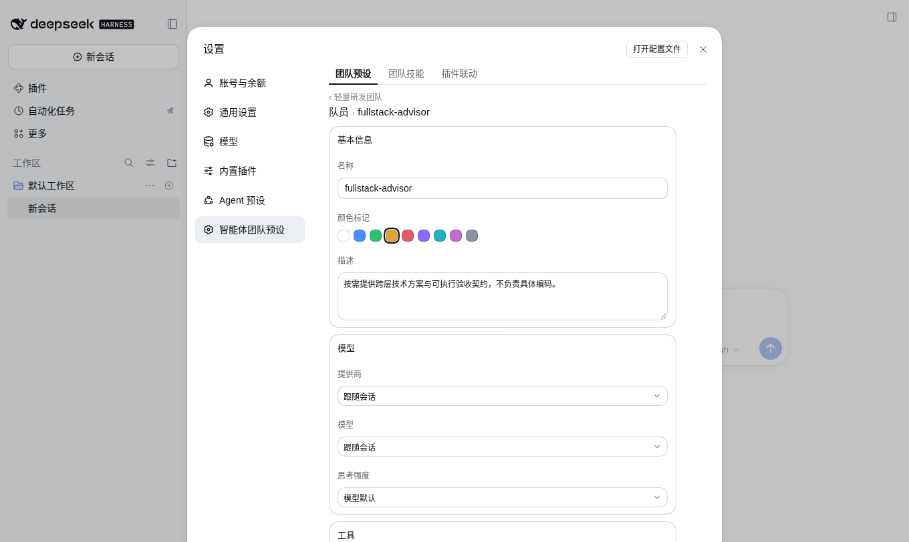
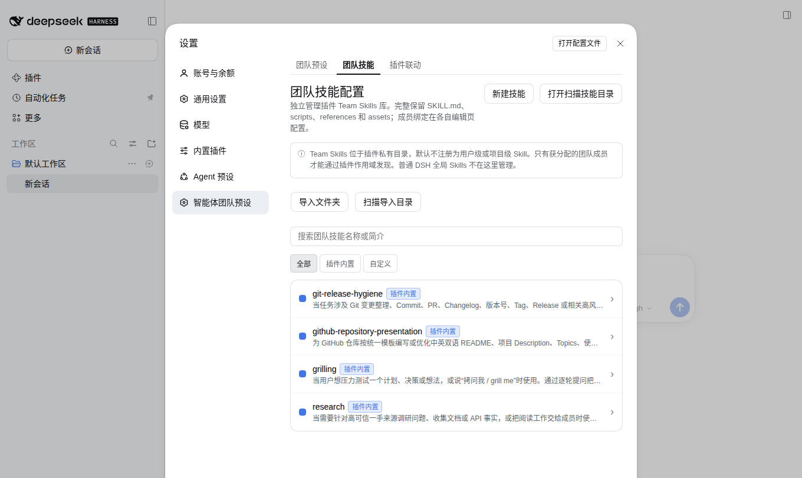
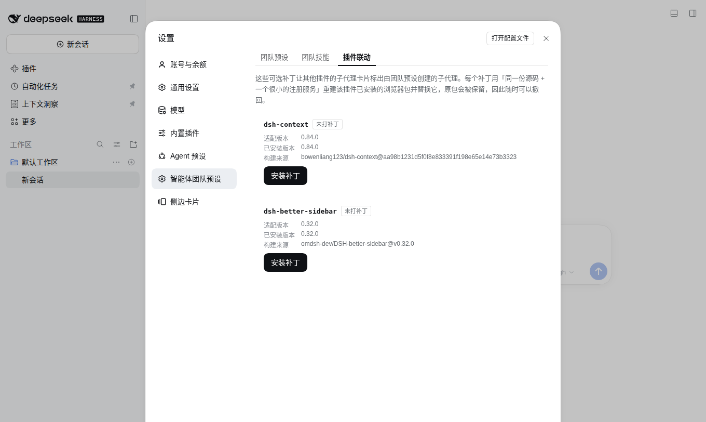
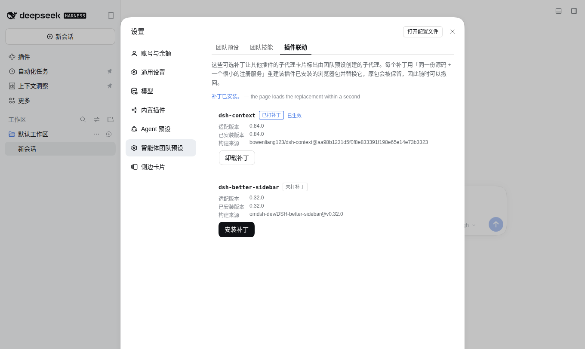
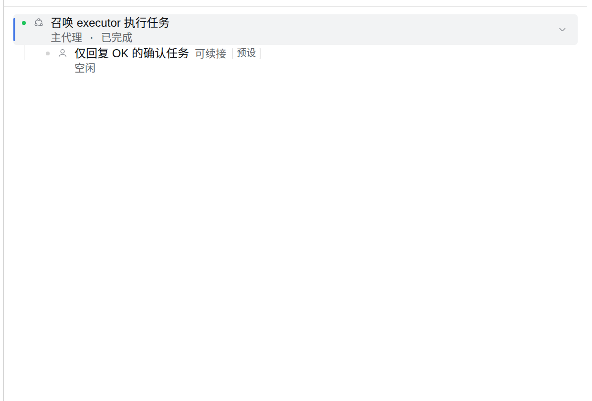

# 新手必读：从零用起智能体团队预设

这篇教程假设你**从没用过这个插件**。跟一遍，你会知道每个按钮在哪、点了会发生什么。

> 截图全部来自一个只装了本插件的隔离实例（默认工作区、9 个内置团队），所以界面上没有你的会话与自定义内容；你看到的菜单会比截图多，那是别的插件加的。

---

## 1. 这个插件到底给你什么

一句话：**把「一个队长 + 若干各带模型与工具权限的队员」保存成一套预设，在对话里一键换上。**

装上之后你会得到三样东西：

| 你会看到 | 在哪 | 作用 |
| --- | --- | --- |
| 「不加载预设」下拉 | 输入框左下角 | 给当前会话选一套团队 |
| 「智能体团队预设」设置页 | 设置 → 左侧导航 | 新建、编辑、导入导出团队 |
| 「团队」按钮 | 会话头部（选好团队后出现） | 看队长与队员、共享任务进度 |

---

## 2. 第一步：在对话里选一个团队

先确认输入框右侧的开关是开着的：点模型按钮，最下面一行是 **「启用智能体团队协作」**，它控制本会话是否允许团队协作。关着的时候，团队入口不会出现。

看到 `不加载预设 ⌄` 了吗？点它。

这个面板里有：

- **搜索框**：按团队名、标签、适用场景搜索；
- **团队来源**：插件内置 / 自定义；
- **团队分类**：研发规模 / 工作模式，以及你自己建的分组；
- 列表本身：每行是「团队名 + 一句话说明」，第一行 `不加载预设` 表示退回无团队模式。

**怎么选**：直接点某一行。当前会话会立刻换上这套团队，输入框上显示团队名。

---

## 3. 看看团队里都有谁

把鼠标**停在某个团队上**（不用点），右边会展开成员面板：

面板分成两段：

- **队长**（`team-lead`）：它接管本会话 —— 队长的系统提示词变成会话提示词、工具权限作用于会话工具。**队长永远用你当前选的模型**，团队不会偷偷改你的模型。
- **队员**：每个队员显示自己的模型（`会话模型` 表示跟随会话）和职责描述。

点队员那一行，会把你切换到和这个队员单独对话，而不是让队长去调度 —— 适合你想直接指挥某个角色时用。

---

## 4. 管理团队：设置页

打开 **设置 → 左侧「智能体团队预设」**：

顶部三个分页，就是本插件的全部功能：

| 分页 | 内容 |
| --- | --- |
| **团队预设** | 团队列表、新建、导入导出、分类管理 |
| **团队技能** | 私有技能库，按角色分配 |
| **插件联动** | 可选补丁：给其他插件的子代理卡片加「预设」标签 |

列表里每行右侧有 **导出 / 复制 / 删除团队**。上方一排：

- **新建团队**：从空白开始建；
- **导入预设**：读入别人分享的 JSON；
- **管理团队预设分类**：建/改名/排序/删自定义分类；
- **恢复内置预设**：把 9 个内置团队恢复成出厂内容（你自己改过的模型路由和工具策略会保留）。

改完记得点右下角 **保存**；不想留改动就点 **放弃修改**。

---

## 5. 编辑一个团队

点列表里任意一行，进入团队编辑页：

从上到下：

1. **团队名称 / 团队用途说明** —— 说明会出现在选择面板里，也用于搜索；
2. **队长 · team-lead** —— 点开可以改队长的角色描述、系统提示词、工具策略；
3. **队员** —— 每行一个角色，右侧可删除，右上角 **添加队员**；
4. **所属分类** —— 只用于本地分组，不会导出、不会进入运行时；
5. **团队展示信息** —— 简介、标签、适用场景、推荐任务、备注。**这部分绝不注入模型上下文**，只用于展示与检索，放心写。

### 队员页面：模型路由与工具权限

点某个队员：

- **基本信息**：名称、颜色标记（名册里显示的颜色）、描述；
- **模型**：提供商 / 模型 / 思考强度。默认都是 `跟随会话`，改成具体模型后，这个队员就固定跑在那个模型上（队长不受影响）；
- **工具**：默认继承部署的全部工具，也可以改成自定义白名单，只给这个角色它能用的工具；
- **系统提示词**：这个角色的行为约定；
- **专属技能**：给这个角色单独绑定团队技能（见下一节）。

---

## 6. 团队技能：只给指定角色的技能

切到 **团队技能** 分页：

这里是一个**插件私有的技能库**，和 DSH 全局技能是两套东西：

- **导入文件夹 / 扫描导入目录 / 新建技能**：把 SKILL.md 连同 scripts、references 一起收进来；
- **插件内置 / 自定义**：四个随包技能（`git-release-hygiene`、`github-repository-presentation`、`grilling`、`research`）标着「插件内置」，可以复制成自定义版本再改；
- 点任一行查看内容、依赖检查与**绑定关系**。

关键规则：技能**只有被分配的那个角色**才能看到。分配入口在队员页的「专属技能」，不在这个列表里 —— 这个列表只管库里有什么。

---

## 7. 插件联动：给别的插件卡片加「预设」标签

这是 0.3.0 新增的分页，也是本插件唯一会改动**其他插件文件**的功能，所以每一步都要你确认。

每行一个目标插件，显示四件事：适配版本、已安装版本、替换包是从哪个上游版本构建的、当前状态。

- `未打补丁` → 有 **安装补丁** 按钮；
- `已打补丁` → 有 **卸载补丁** 按钮；
- `未安装` / `版本不支持` / `已被其他改动修改` → 只说明原因，不给按钮（不会硬来）。

点安装会先弹确认框，写清要替换哪个包、哪个文件、适配哪个版本。确认后：

出现 **已打补丁 · 已生效** 就成功了。**不需要重启 dsh，也不需要刷新页面** —— 运行中的服务会重新发布那个插件的浏览器包，页面就地重新加载它，标签一秒内出现。

装上之后，由预设召唤出来的子代理，在 dsh-context 的编队卡片和 dsh-better-sidebar 的任务卡片上，名字后面会多一个 `预设` 标签；普通子代理不会有。下图中那个橙色圆点成员 `executor` 就是被召唤出来的，它名字右边多了一枚 `预设`：

> 安全边界：替换前会备份原文件，卸载时还原并删除备份；只有当目标是**发布版原始文件**时才允许安装，被其他人改过的一律拒绝。

---

## 8. 召唤成员，看协作过程

选好团队后，正常把任务发给队长即可。队长会按需用 `spawn_team_member` 召唤队员，每个队员带着自己的模型、提示词、工具白名单和专属技能开工。

这时会话头部会出现 **团队** 按钮，点开是：队长 + 已召唤队员的名册（带实时状态与所用模型），下方是共享任务区（每条任务的状态、依赖、写入范围、描述）。点某个队员可以跳到它的会话看它在干什么。

---

## 9. 常见问题

| 现象 | 原因与做法 |
| --- | --- |
| 输入框里看不到团队入口 | 模型菜单里的「启用智能体团队协作」没开 |
| 选了团队但队长行为没变 | 团队在会话的**下一个任务边界**生效；正在跑的任务不会被中途改写 |
| 队员用的是会话模型，不是我配的 | 队员的提供商/模型留的是 `跟随会话`，改成具体模型即可 |
| 团队技能在某个角色上不生效 | 技能是**按角色绑定**的，去队员页的「专属技能」里分配 |
| 插件联动里显示「版本不支持」 | 目标插件版本变了；本插件只对固定版本提供替换包，等新构建 |
| 安装补丁后标签没出现 | 卡片对应的子代理不是由预设召唤的；只有预设创建的成员才带标签 |

更多版本变化见 [GitHub Releases](https://github.com/bloodarea/dsh-agent-team-presets/releases)。
